# Suppa Browser

<a href="https://www.buymeacoffee.com/Un1que0ff"></a>

[English](README.md) · [Русский](README.ru.md) · **Deutsch** · [Español](README.es.md) · [中文](README.zh.md)

**Ein kleiner, schneller, privater Webbrowser für Windows (und jetzt auch Linux) – eine einzige `.exe` mit 3 MB, mit eingebautem Werbeblocker, Chrome-Erweiterungen, Tab-Gruppen und einer frei anpassbaren Oberfläche.**

Geschrieben in Rust auf Basis von Microsoft **WebView2**, der Chromium-Engine, die schon in Windows 10/11 steckt – Seiten sehen also genau aus wie in Chrome/Edge, während Suppa selbst sehr klein bleibt.

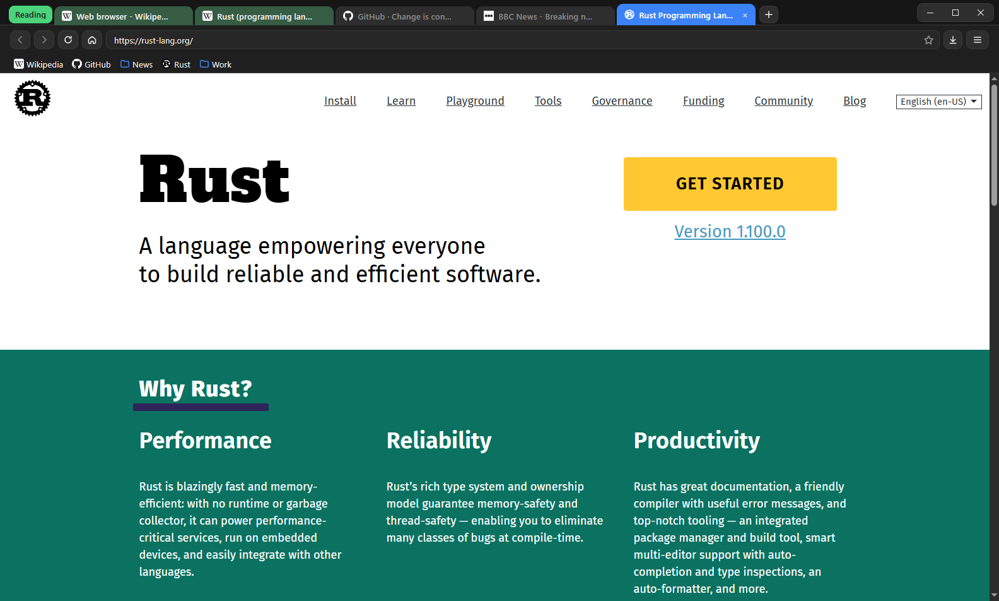

---

## Das Wichtigste

- **Winzig** – eine `Suppa.exe` mit etwa **3 MB**. Keine DLLs, keine Hintergrunddienste. Das kleine optionale Setup nutzen oder einfach die exe starten.
- **Schnell** – Fenster und Symbolleiste sind nach etwa **0,2 s** bereit, der Werbeblocker nach **25 ms**.
- **Sparsam mit CPU und RAM** – Hintergrund-Tabs schlafen ein und werden automatisch entladen; im Leerlauf etwa **0,1 % eines CPU-Kerns**.
- **Privat** – kein Konto, keine Telemetrie, keine Analyse. Suppa selbst sendet nie etwas über dich irgendwohin (Details unten).
- **Werbe- und Trackerblocker eingebaut** – Braves Ad-Block-Engine mit EasyList, EasyPrivacy, uBlock-Filtern und Schnellkorrekturen, Cookie-Banner-Listen und deinen eigenen Regeln.
- **YouTube-Werbung übersprungen** – Werbung, die durchkommt, wird stummgeschaltet, ans Ende gespult und ihre **Überspringen**-Schaltfläche für dich gedrückt (mit einem echten Klick, den YouTube akzeptiert); Werbeplätze im Feed und neben Videos werden ausgeblendet.
- **Cookie-Hinweise erledigt** – standardmäßig **nur notwendige Cookies** („Alle ablehnen“) oder „Alle akzeptieren“, wenn du willst (Einstellungen → Datenschutz; abschaltbar).
- **Adressen, Karten und PayPal** – speichere mehrere Adressen, Zahlungskarten und PayPal-Konten (in den Einstellungen oder aus einem abgesendeten Formular) und fülle sie mit einem Klick aus; Karten erst nach Windows Hello, Sicherheitscodes werden nie gespeichert.
- **Sichere Passwörter** – Registrierungsformulare bekommen ein erzeugtes Passwort wie `A%$3G&8^ga12Kq`, das Suppa ausfüllt und für die Seite speichert.
- **Mit Dropbox synchronisieren und teilen** (optional) – Passwörter, Adressen und Karten in einer Datei, verschlüsselt mit deiner Passphrase, über die Dropbox-App; jeder PC oder Mensch mit demselben Ordner und derselben Passphrase bekommt sie.
- **Player und Lautstärke pro Tab** – eine Player-Schaltfläche neben den Downloads zeigt, was läuft (Albumcover von Spotify / Tidal, kleine Videovorschau von YouTube), mit Wiedergabe / Pause, Weiter und einem Lautstärkeregler für jeden Tab, unabhängig von der Windows-Lautstärke. Tabs zeigen einen Lautsprecher, ein Klick schaltet stumm.
- **Video / MP3 speichern** – Rechtsklick auf ein Video (oder eine YouTube-Seite) und speichern, oder nur den Ton als MP3.
- **Tab wach halten** – ausgewählte Tabs schlafen im Hintergrund nie ein.
- **Chrome-Erweiterungen** – Installation aus dem Chrome Web Store mit **Add to Suppa**, mit Schaltflächen und Popups neben der Adressleiste.
- **Tab-Gruppen** – einen Tab auf einen anderen ziehen und halten: sie bilden eine farbige, einklappbare Gruppe.
- **Leiste mit gespeicherten Tabs** mit Ordnern und Drag & Drop, ein ☆ speichert eine Seite mit einem Klick.
- **Deine Anordnung** – Tabs, Adressleiste und gespeicherte Tabs jeweils, wo du willst: oben, unten oder als Spalte links/rechts (z. B. Adressleiste oben, Tabs und gespeicherte Tabs links).
- **Deine Sprache** – Englisch, Russisch, Deutsch, Spanisch oder Chinesisch (standardmäßig die Windows-Sprache; Einstellungen → Darstellung → Sprache).
- **Dein Aussehen** – Designs dunkler / dunkel / hell / heller, eine Tönung über die ganze Oberfläche, jede Akzentfarbe (oder der Windows-Akzent), jede Oberflächenfarbe, runde oder Squircle-Ecken, welche Tab-Ecken rund sind, fünf Symbolstile, Oberflächengröße.
- **Inkognito-Tabs**, Tabs sortieren, Tab in ein neues Fenster ziehen, Wiederherstellung nach Absturz, Sicherung & Wiederherstellung, Lesezeichenimport.
- **Passwortmanager** – gespeicherte Passwörter ansehen, suchen, kopieren und löschen (vorher wird Windows Hello oder dein Windows-Passwort abgefragt); Import aus Firefox, Chrome, Edge oder Brave und Export als `.csv`.
- **Verlauf, Downloads und Verknüpfungen** – eine durchsuchbare Verlaufsseite, eine Download-Schaltfläche neben der Adressleiste, die sich beim Herunterladen mit deiner Akzentfarbe füllt, und deine meistbesuchten Seiten mit ihren Symbolen auf einer Startseite in deinem Design.
- **Seitensymbole passend zum Design** – in Tabs, gespeicherten Tabs, im Verlauf und auf der Startseite; weiße Symbole werden im hellen Design dunkel, schwarze im dunklen hell.
- **Aktualisiert sich selbst** – prüft einmal am Tag GitHub; mit dem Setup installiert, aktualisiert es sich mit einem Klick und zeigt, was neu ist.
- **Anpassbar** – die ganze Oberfläche ist einfaches HTML/CSS/JS in einem Ordner neben der exe; bearbeiten und **Update** drücken.

---

## Screenshots

| | |
|---|---|
|  | 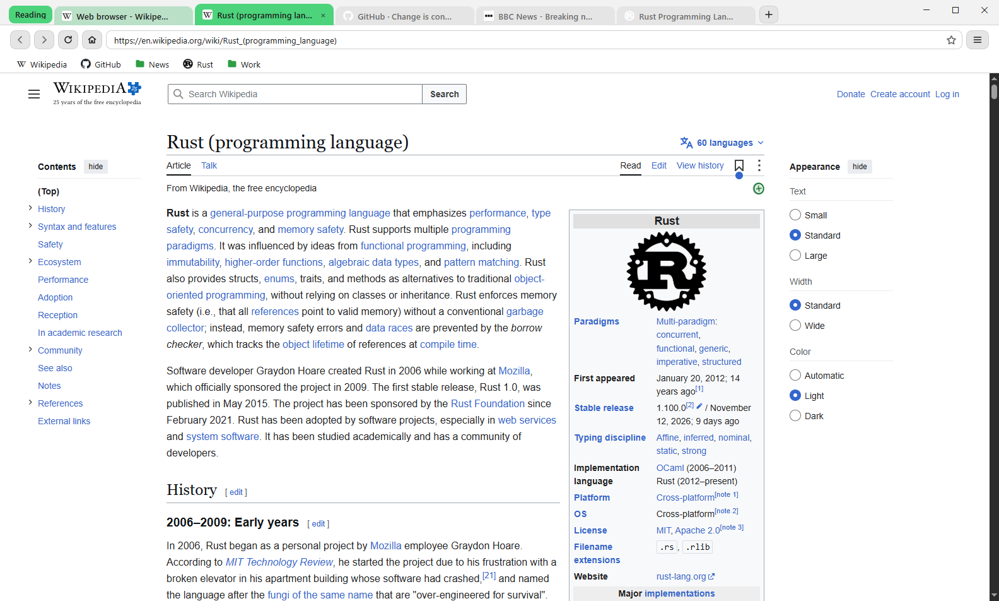 |
| **Dunkles Design** (blauer Akzent) – Tab-Gruppe „Reading“, Leiste mit gespeicherten Tabs, Download-Schaltfläche neben der Adressleiste | **Helles Design** (Indigo-Akzent) – Seitensymbole passen sich dem Design an |
| 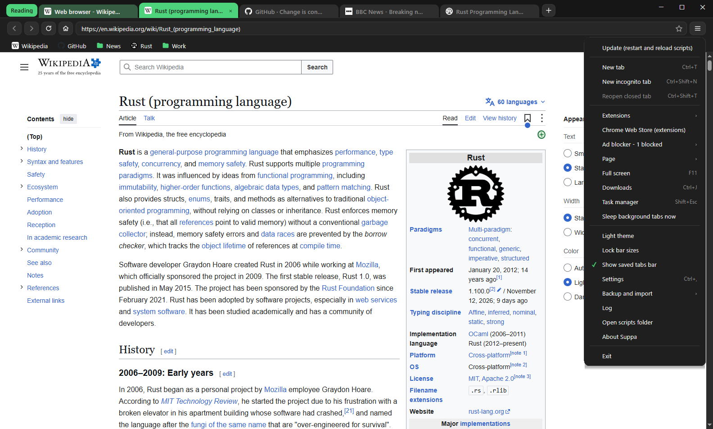 | 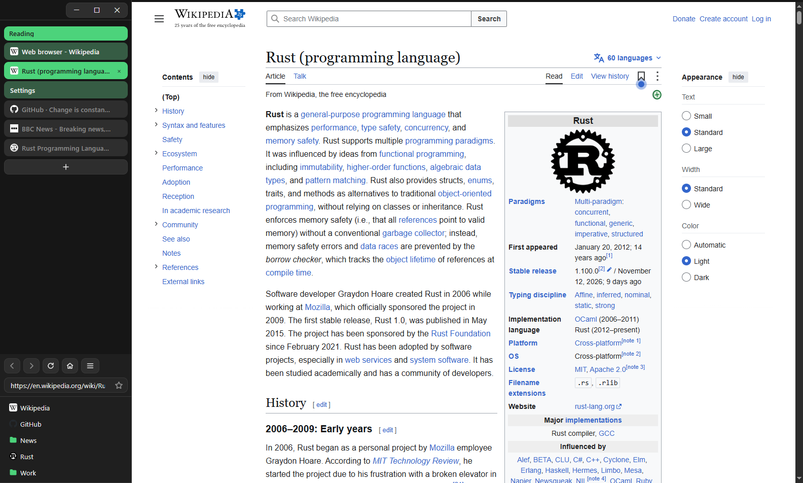 |
| **Das ≡-Menü** (orangefarbener Akzent) – jedes Menü folgt dem Design des Browsers | **Leiste links** (limettengrüner Akzent) – senkrechte Tabs, Adresse und gespeicherte Tabs in einer Spalte |
| 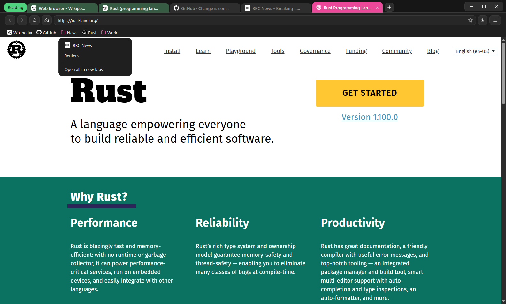 | 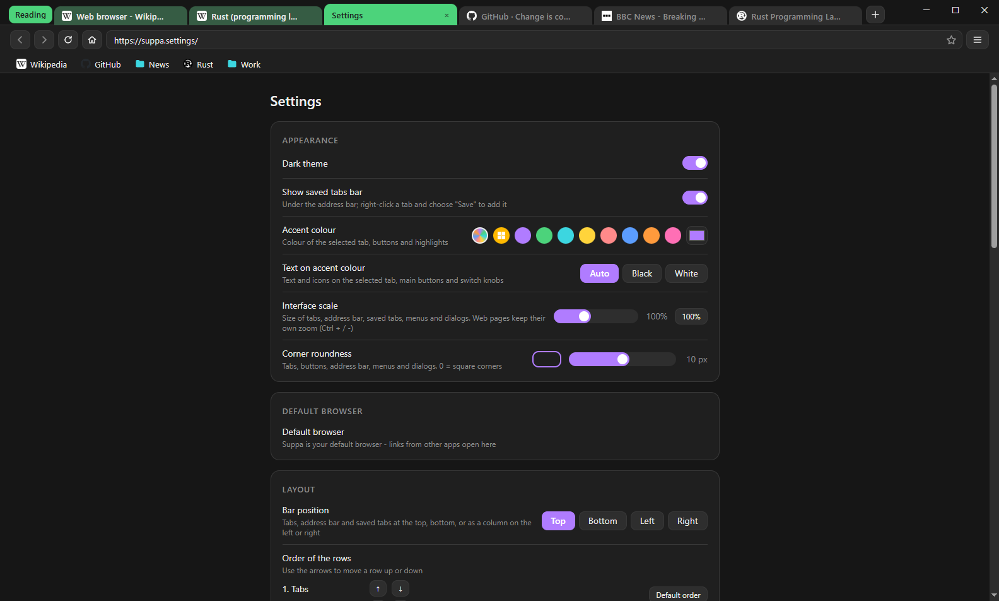 |
| **Gespeicherte Tabs** (rosa Akzent) – Ordner öffnen sich als Menüs; zum Sortieren ziehen | **Einstellungen** (gelber Akzent) – links in Bereiche gegliedert: Aussehen, Ecken, Anordnung, Datenschutz, Passwörter, Sicherung, Updates |
| 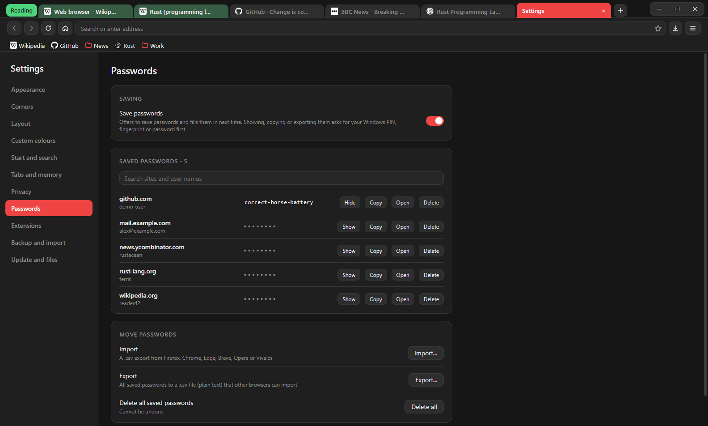 | 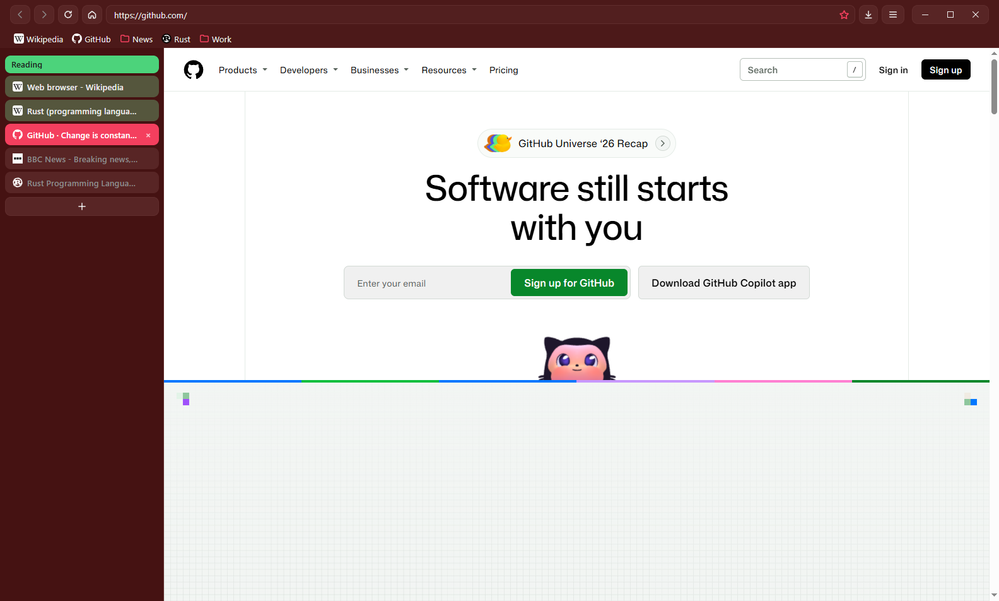 |
| **Passwortmanager** (roter Akzent, Demo-Einträge) – suchen, anzeigen, kopieren, löschen; Import aus Firefox, Chrome, Edge oder Brave und Export als `.csv` | **Deine Anordnung und dein Aussehen** (Rosé-Akzent) – Tabs links, Adressleiste oben, dunkles Design mit 20 % roter Tönung |
| 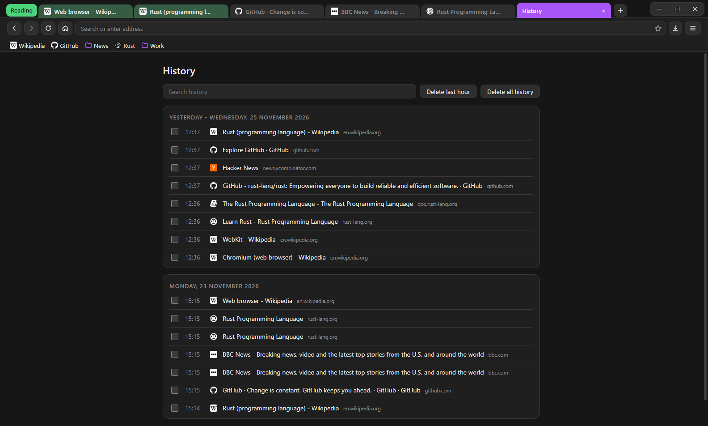 | 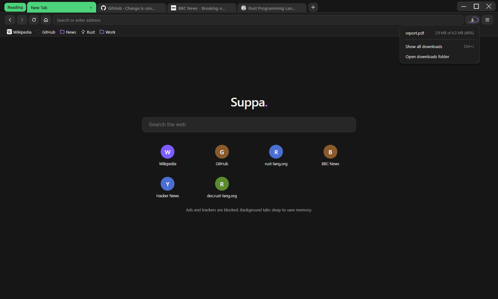 |
| **Verlauf** (`Strg+H`, violetter Akzent) – nach Tagen gruppiert, mit Seitensymbolen und Suche | **Startseite** (petrolfarbener Akzent) – deine meistbesuchten Seiten mit Symbolen und ein Download, der die Download-Schaltfläche füllt |

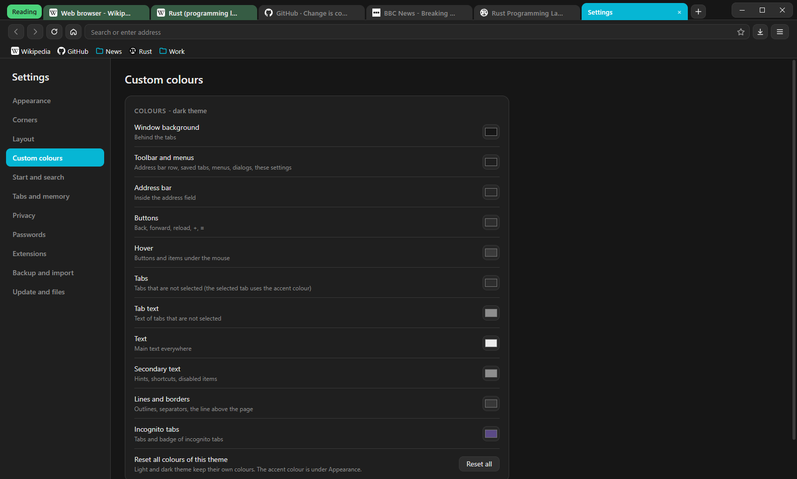
*Einstellungen → Eigene Farben (Cyan-Akzent): jede Farbe der Oberfläche ändern (getrennt für helles und dunkles Design).*

---

## Geschwindigkeit und Speicher

Gemessen unter Windows 10 (WebView2 157), Suppa 0.4, eine Webseite offen, 60 s nach dem Start:

| | |
|---|---|
| Programmgröße | **3,0 MB** (`Suppa.exe`, alles enthalten) |
| Fenster + Symbolleiste bereit | **~0,19 s** nach dem Start |
| Werbeblocker bereit | **25 ms** nach dem Start (zwischengespeicherte Filter-Engine, 1–2 ms im UI-Thread) |
| CPU im Leerlauf | **63 ms CPU-Zeit pro Minute** für alle Suppa-Prozesse zusammen (≈ **0,1 %** eines Kerns) |
| Speicher von `Suppa.exe` selbst | **13 MB** |
| Ganzer Browser (alle Engine-Prozesse, 1 Seite) | **~270 MB** privater Speicher, 8 Prozesse |

Warum er leicht bleibt:

- **Schlafende Tabs** – Tabs, die du 5 Minuten nicht angesehen hast, werden eingefroren (0 % CPU); nach 30 Minuten werden sie entladen und geben ihren Speicher frei. Ein Klick auf den Tab lädt ihn wieder. Tabs mit Ton und wach gehaltene Tabs schlafen nie. (Die Zeiten lassen sich in den Einstellungen ändern.)
- **Verzögertes Wiederherstellen** – Tabs der letzten Sitzung laden erst, wenn du sie anklickst.
- **Gemeinsame Prozesse** – Tabs derselben Seite teilen sich einen Renderprozess; Symbolleiste und Menüs teilen sich einen anderen.
- **Nichts läuft im Hintergrund** – Dateiänderungen werden über Windows-Benachrichtigungen statt durch Abfragen erkannt; ein minimiertes Fenster zeichnet nichts.
- **Schnelles Zeichnen** – Seiten werden von 4 Raster-Threads und auf der Grafikkarte gezeichnet; große Downloads nutzen mehrere Verbindungen.

Der meiste Speicher gehört der Chromium-Engine selbst (Seitendarstellung, GPU-Prozess, Netzwerk). Suppa kommt mit etwa 13 MB dazu.

---

## Datenschutz

**Suppa sammelt keine Daten.** Im Code von Suppa gibt es kein Konto, keine Telemetrie, keine Analyse, keine Absturzberichte und kein „Nach-Hause-Telefonieren“. Alles bleibt auf deinem PC in `%LOCALAPPDATA%\SuppaBrowser`.

Die einzigen Verbindungen, die Suppa selbst aufbaut:

| Wann | Wohin | Wozu |
|---|---|---|
| Beim ersten Start, dann alle 4 Tage | easylist.to, ublockorigin.github.io, secure.fanboy.co.nz, raw.githubusercontent.com | die Werbefilterlisten herunterladen |
| Nur wenn du **Add to Suppa** klickst | clients2.google.com | diese Erweiterung aus dem Chrome Web Store herunterladen |
| Einmal am Tag (abschaltbar unter Einstellungen → Updates und Dateien) und wenn du **Nach Updates suchen** klickst | api.github.com, github.com | die neueste Versionsnummer und ihre Versionshinweise lesen; das Update herunterladen, wenn du **Jetzt aktualisieren** klickst |
| Was du in die Adressleiste tippst | die gewählte Suchmaschine (Google, DuckDuckGo, Bing, Brave) | deine Suche |
| Nur beim ersten Mal **Video / MP3 speichern** (du wirst vorher gefragt), danach höchstens einmal pro Woche beim Speichern eine Update-Prüfung von yt-dlp | github.com | yt-dlp und FFmpeg in Suppas Datenordner (`tools\`) herunterladen |

**Dropbox-Synchronisation** (aus, bis du sie einschaltest) baut selbst keine Verbindung auf: Suppa schreibt eine Datei in deinen Dropbox-Ordner, und die Dropbox-App synchronisiert sie. Die Datei ist mit deiner Passphrase verschlüsselt (PBKDF2-SHA256 + AES-256-GCM), Dropbox kann sie also nicht lesen.

Zusätzlicher Datenschutz: Werbung und Tracker werden blockiert, Tracking-Anfragen über `<a ping>` sind abgeschaltet, Edge-Extras (Shopping, Übersetzer, SmartScreen) sind deaktiviert, Inkognito-Tabs behalten nach dem Schließen nichts.

*Webseiten werden von Microsofts WebView2-Laufzeit (Teil von Windows) angezeigt. Wie jede Windows-Komponente folgt sie den Diagnosedaten-Einstellungen von Windows selbst (Einstellungen → Datenschutz → Diagnose und Feedback) – das ist eine Sache zwischen Windows und Microsoft, nicht Suppa.*

---

## Funktionen

### Tabs
- **Neu / schließen / wieder öffnen**: `Strg+T` (oder `Strg+N`), `Strg+W` oder Mittelklick, `Strg+Umschalt+T` öffnet den zuletzt geschlossenen Tab an seiner alten Stelle wieder.
- **Sortieren**: einen Tab nach links/rechts ziehen – die anderen weichen aus. Weiche Animationen; Tabs werden erst schmaler, wenn die Zeile voll ist.
- **Tab-Gruppen**: einen Tab ziehen und **über der Mitte eines anderen Tabs halten** → sie werden eine Gruppe (oder der Tab kommt in die Gruppe des anderen). Jede Gruppe hat ein farbiges Etikett: Klick klappt ein/aus, Rechtsklick zum Umbenennen, Farbe ändern, Gruppe auflösen oder schließen. Tabs einer Gruppe sind in ihrer Farbe getönt. Rechtsklick auf einen Tab → *Zu neuer Gruppe hinzufügen / Aus Gruppe entfernen / Gruppe auflösen*. Gruppen werden mit der Sitzung gespeichert.
- **Neues Fenster**: einen Tab aus dem Fenster ziehen und loslassen – er öffnet sich in einem neuen Fenster (gleiche Anmeldungen und Erweiterungen).
- **Inkognito**: `Strg+Umschalt+N` – ein eigenes privates Profil; nichts wird gespeichert.
- **Wiederherstellung nach Absturz**: offene Tabs und Gruppen werden 2 Sekunden nach jeder Änderung gespeichert und kommen nach einem Absturz immer zurück.

### Gespeicherte Tabs (Lesezeichen)
- ☆ am Ende der Adressleiste speichert die aktuelle Seite (★ = gespeichert, erneuter Klick entfernt sie), oder Rechtsklick auf einen Tab → *Speichern*.
- Zum Sortieren ziehen. Einen Eintrag auf die Mitte eines anderen fallen lassen → ein Ordner mit beiden. Auf einen Ordner fallen lassen → hinein verschieben. Einen Link aus einem offenen Ordner auf die Leiste ziehen, um ihn herauszunehmen.
- Rechtsklick für *In neuem Tab / inkognito öffnen, Umbenennen, Löschen, Neuer Ordner*.

### Werbeblocker und Cookie-Hinweise
- Netzwerkblockierung, kosmetisches Ausblenden und Anti-Werbe-Scriptlets (Braves `adblock-rust`-Engine).
- ≡ → *Werbeblocker*: sehen, wie viele Anfragen blockiert wurden, Werbung auf einer Seite erlauben, Listen aktualisieren.
- Eigene Regeln: `scripts\filters\*.txt` (uBlock- / AdBlock-Syntax).
- Cookie-Banner werden automatisch beantwortet (viele Sprachen): standardmäßig **nur notwendige** Cookies („Alle ablehnen“ / „Nur notwendige“ oder das × des Banners, wenn es keine solche Schaltfläche hat) oder **alle akzeptieren** – Einstellungen → Datenschutz. Dort auch abschaltbar.
- YouTube: Videowerbung wird stummgeschaltet, ans Ende gespult und die **Überspringen**-Schaltfläche mit einem echten (vertrauenswürdigen) Mausklick gedrückt, du musst sie also nie selbst drücken.

### Adressen, Zahlungen und Passwörter
- **Einstellungen → Adressen und Zahlungen**: beliebig viele Adressen (Zuhause, Arbeit, ...), Zahlungskarten und PayPal-Konten hinzufügen oder Suppa beim Absenden eines Formulars das Speichern anbieten lassen. Alles ist für dein Windows-Konto verschlüsselt (`vault.dat`).
- In Webformularen erscheint in Adress-, Karten-, PayPal- und Passwortfeldern eine kleine **Schlüssel-Schaltfläche**. Sie öffnet Suppas eigenes Menü – die Seite sieht nie, was du gespeichert hast – und füllt nur das aus, was du wählst. Karten werden nach Windows Hello ausgefüllt; der Sicherheitscode (CVC) wird nie gespeichert. Bietet ein Shop auch PayPal an, hat das Menü **Stattdessen mit PayPal zahlen**; auf der Anmeldeseite von PayPal wird deine PayPal-E-Mail ausgefüllt.
- **Sichere Passwörter**: in einem Registrierungsformular bietet die Schlüssel-Schaltfläche ein erzeugtes Passwort an (Groß- und Kleinbuchstaben, Ziffern, Sonderzeichen). Suppa füllt es in beide Passwortfelder ein, speichert es für die Seite und legt es beim nächsten Start in den eigenen Passwortspeicher des Browsers. Einstellungen → Passwörter hat auch einen Generator (`Strg+Umschalt+G` kopiert eines).
- **Mit Dropbox synchronisieren und teilen** (Einstellungen → Passwörter, standardmäßig aus): eine Datei in `Dropbox\Apps\Suppa`, verschlüsselt mit deiner Passphrase. Jeder PC mit derselben Passphrase – und jeder, mit dem du diesen Dropbox-Ordner teilst – bekommt dieselben Passwörter, Adressen und Karten; Änderungen werden pro Eintrag zusammengeführt, Löschungen weitergegeben. Stattdessen kann auch jeder andere synchronisierte Ordner gewählt werden (OneDrive, ein USB-Stick).

### Medien
- **Player-Schaltfläche** neben der Download-Schaltfläche (≡ → Aussehen und Symbolleiste → Player-Schaltfläche anzeigen), solange ein Tab spielt: Albumcover (Spotify, Tidal, SoundCloud, YouTube Music...) oder eine kleine Live-Vorschau des Videos (YouTube und die meisten Videoseiten), Wiedergabe / Pause, Zurück / Weiter, Stumm und ein **Lautstärkeregler nur für diesen Tab** – die Windows-Lautstärke bleibt, wie sie ist. Ein Klick auf den Titel wechselt zum Tab. `Strg+Umschalt+M` öffnet ihn.
- Spielende Tabs zeigen einen **Lautsprecher** (Klick = stumm, `Strg+M`); Rechtsklick auf einen Tab → **Ton** für Stumm und 100 / 75 / 50 / 25 / 10 % Lautstärke.
- **Video / MP3 speichern**: Rechtsklick auf ein Video oder Audio (oder irgendwo auf einer Seite von YouTube, Vimeo, SoundCloud...), das Player-Popup oder ≡ → Diese Seite. Einfache Videodateien werden direkt heruntergeladen; Streaming-Seiten und MP3s nutzen die kostenlosen Programme yt-dlp und FFmpeg, die Suppa einmal nach Rückfrage herunterlädt. Die Dateien landen in deinem Download-Ordner. (Speichere nur, was du darfst.)
- **Wach halten**: Rechtsklick auf einen Tab → *Wach halten* (oder ≡ → Diese Seite): er wird im Hintergrund nie eingefroren oder entladen (auf dem Tab ist eine kleine Sonne zu sehen).

### Erweiterungen
- Eine Erweiterung im Chrome Web Store öffnen und **Add to Suppa** klicken (Suppa lädt und installiert sie selbst).
- Erweiterungs-Schaltflächen erscheinen rechts der Adressleiste: Klick = Popup der Erweiterung unter der Schaltfläche, Rechtsklick = Optionen / ausblenden / entfernen.
- ≡ → *Erweiterungen* listet alle auf (aktivieren/deaktivieren, Optionen, in der Symbolleiste zeigen, entfernen) und kann einen entpackten Ordner laden.

### Aussehen und Anordnung (Einstellungen)
- **Sprache**: English, Русский, Deutsch, Español oder 中文 – Menüs, Einstellungen, die Leiste und Suppas Seiten. *Automatisch* (Standard) nimmt die Anzeigesprache von Windows oder Englisch, wenn Suppa sie nicht hat. Die Übersetzungen stehen in `scripts\lang.json`.
- **Design**: **System** (hell oder dunkel wie Windows – Standard), dunkler (schwarz), dunkel, hell, heller (weiß); **Tönung**: jede Farbe über der ganzen Oberfläche, 0–60 % (z. B. dunkel mit 20 % Rot). Akzentfarbe: Regenbogen pro Tab, 8 Vorgaben, jede Farbe oder **die Windows-Akzentfarbe** (Standard); Text auf Akzent: auto / schwarz / weiß.
- **Oberflächengröße** 75–150 % (Seiten behalten ihren eigenen Zoom), **Eckenrundung** 0–20 px, **Eckenstil** rund oder **Squircle** (weiche Superellipsen-Ecken überall, auch in Menüs).
- **Tab-Ecken**: welche der vier Ecken eines Tabs rund sind (oder Auto).
- **Symbolstil**: Linie, Fett, Scharf, Gefüllt oder Zweifarbig (Symbolleiste, gespeicherte Tabs, Fensterschaltflächen).
- **Einstellungen → Eigene Farben**: jede Farbe der Oberfläche, pro Design.
- **Anordnung**: jede Zeile (Tabs, Adressleiste, gespeicherte Tabs) **oben, unten, links oder rechts**, oder alle auf einmal; Zeilen links/rechts teilen sich eine Spalte mit senkrechten Tabs (ihren Rand ziehen, um die Breite zu ändern). Zeilen am selben Rand folgen der gewählten **Reihenfolge**. Ist oben keine Zeile, schweben die Fensterschaltflächen über der oberen rechten Ecke der Seite.
- Die dünne Linie unter einer Zeile ziehen, um ihre Höhe zu ändern; ≡ → *Leistengrößen sperren* verhindert Versehen.
- Das Fenster hat keine Windows-Titelleiste – die Tab-Zeile *ist* die Titelleiste (ziehen zum Verschieben, Doppelklick zum Maximieren).

### Passwörter, Sicherung und Import
- Passwörter und Formulardaten werden gespeichert und ausgefüllt (abschaltbar).
- **Passwortmanager**: Einstellungen → Passwörter listet jedes gespeicherte Passwort mit Suche, Anzeigen, Kopieren, Öffnen und Löschen (Löschen wirkt beim Neustart von Suppa; die Engine sperrt ihren Speicher, solange sie läuft). **Export** schreibt alle in eine `.csv`-Datei, die andere Browser importieren können. Anzeigen, Kopieren und Export fragen Windows zuerst, wer du bist (**Windows Hello** – PIN, Fingerabdruck oder Gesicht – oder dein Windows-Passwort); eine Prüfung gilt eine Minute.
- **Sicherung**: eine `.zip` mit Einstellungen, Leistengrößen, gespeicherten und offenen Tabs, Skripten, Erweiterungen, gespeicherten Passwörtern, Formulardaten und Website-Anmeldungen. **Wiederherstellen** wendet sie beim nächsten Start an. (Passwörter sind von Windows für dein Konto verschlüsselt, sie lassen sich also auf demselben Windows-Konto wiederherstellen.)
- **Lesezeichen importieren** aus Chrome, Edge, Brave, Vivaldi, Opera oder Firefox (werden automatisch gefunden) oder aus einer exportierten Lesezeichen-`.html`-Datei.
- **Passwörter importieren** aus einem Passwort-Export von Firefox, Chrome, Edge oder Brave (`.csv`): Einstellungen → Passwörter → Importieren oder ≡ → Sicherung und Import → Passwörter aus einer Datei importieren. In Brave: brave://password-manager/settings → Export passwords. In Firefox: about:logins → ⋯ → Zugangsdaten exportieren. Die Passwörter werden sofort für dein Windows-Konto verschlüsselt und kommen beim Neustart in Suppas Passwortspeicher; danach bietet Suppa an, die Exportdatei zu löschen (sie enthält die Passwörter im Klartext).

### Verlauf und Downloads
- **Verlauf** (`Strg+H`, ≡ → Verlauf): jede in einem normalen Tab geöffnete Seite, nach Tagen gruppiert, mit Suche; einzelne Seiten, die letzte Stunde oder alles löschen. Beim ersten Start wird der Verlauf übernommen, den die Engine schon hatte. Inkognito-Tabs werden nie aufgezeichnet.
- **Verknüpfungen auf der Startseite**: die Suppa-Startseite zeigt deine 8 meistbesuchten Seiten der letzten 90 Tage mit den Symbolen ihrer Tabs (ein farbiger Buchstabe für eine Seite ohne Symbol); × entfernt eine. Die Startseite nutzt dein Design und deine Akzentfarbe und zeigt die Suppa-Version. Gespeicherte Tabs und der Verlauf zeigen dieselben Symbole, importierte Lesezeichen bekommen ihres also, sobald du die Seite besuchst.
- **Downloads**: kein Download-Fenster von Edge mehr. Beginnt ein Download, öffnet sich ein Popup mit dem Fortschritt, und die Download-Schaltfläche neben der Adressleiste füllt sich im Uhrzeigersinn mit der Akzentfarbe (abschaltbar unter ≡ → Download-Schaltfläche anzeigen). Klick = öffnen / pausieren / fortsetzen, Rechtsklick = Im Ordner zeigen, Abbrechen, Erneut herunterladen, Entfernen. Die **Download-Seite** (`Strg+J`) listet jeden Download mit Suche, Öffnen, Im Ordner zeigen, Pause / Fortsetzen und Abbrechen.

### Updates
- Einmal am Tag fragt Suppa GitHub nach der neuesten Version (nur die Versionsnummer; abschaltbar unter Einstellungen → Updates und Dateien). ≡ → **Nach Updates suchen** fragt sofort.
- Mit dem Setup installiert: **Jetzt aktualisieren** lädt die neue `SuppaSetup.exe` herunter und führt sie still aus; Suppa schließt sich, aktualisiert sich und öffnet sich wieder mit deinen Tabs. Eine portable Kopie öffnet stattdessen die Download-Seite.
- Nach einem Update zeigt **Neuigkeiten** die Versionshinweise dieser Version von GitHub (auch unter Einstellungen → Updates und Dateien).

### Alles andere
- Menüs im Browser-Design überall (≡, Tabs, gespeicherte Tabs, Rechtsklick auf Seiten) und passende Dialoge. Rechtsklick auf eine Seite → **Element untersuchen** öffnet die Entwicklertools an diesem Element.
- Suppa zum **Standardbrowser** machen (Einstellungen oder die Frage beim ersten Start).
- Merkt sich Fenstergröße und -position, Vollbild (`F11`), Drucken, Entwicklertools, Task-Manager.
- Eigene Benutzerskripte: `scripts\userscripts\*.js` (mit `// @match`-Mustern).

---

## Tastenkürzel

Dieselben Tasten wie in Chrome, Edge und Firefox. `F1` (≡ → Hilfe und Updates → Tastenkürzel) zeigt alle in Suppa.

| Tasten | Aktion |
|---|---|
| `Strg+T` / `Strg+N` | Neuer Tab |
| `Strg+Umschalt+N` | Neuer Inkognito-Tab |
| `Strg+W`, `Strg+F4` / `Strg+Umschalt+W` | Tab schließen / Fenster schließen |
| `Strg+Umschalt+T` | Geschlossenen Tab wieder öffnen |
| `Strg+Tab`, `Strg+Bild↓` / `Strg+Umschalt+Tab`, `Strg+Bild↑` | Nächster / vorheriger Tab |
| `Strg+Umschalt+Bild↑` / `Strg+Umschalt+Bild↓` | Tab nach links / rechts verschieben |
| `Strg+1` … `Strg+9` | Zu Tab 1…8 / zum letzten Tab |
| `Strg+M` | Tab stumm / laut schalten |
| `Strg+L`, `Alt+D`, `F6`, `Strg+E`, `Strg+K` | Adressleiste (`Strg+Enter` macht aus `name` → `www.name.com`) |
| `F5`, `Strg+R` / `Strg+F5`, `Strg+Umschalt+R` | Neu laden / ohne Cache neu laden |
| `Alt+Links` / `Alt+Rechts` / `Alt+Pos1` | Zurück / vor / Startseite |
| `Strg+D` / `Strg+Umschalt+B` | Seite in der Leiste speichern / Leiste ein- oder ausblenden |
| `Strg++` / `Strg+-` / `Strg+0` | Vergrößern / verkleinern / zurücksetzen |
| `Alt+S`, `Strg+,` | Einstellungen |
| `Alt+F`, `Alt+E`, `F10` | ≡-Menü öffnen |
| `F11` | Vollbild |
| `Strg+H` / `Strg+J` / `Umschalt+Esc` | Verlauf / Downloads / Task-Manager |
| `Strg+Umschalt+M` / `Strg+Umschalt+G` | Player / neues sicheres Passwort kopieren |
| `Strg+O` / `Strg+U` | Datei öffnen / Seitenquelltext |
| `Strg+Umschalt+Entf` | Browserdaten löschen |
| `Strg+P`, `Strg+F`, `F12`, `Strg+Umschalt+I` | Drucken, Suchen, Entwicklertools |
| `F1` | Liste der Tastenkürzel |

`Strg+D`, `Strg+E`, `Strg+K`, `Strg+M` und `Strg+U` gehen zuerst an die Seite, wie in Chrome: ein Editor, der sie selbst nutzt (Link mit `Strg+K`, Unterstreichen mit `Strg+U`), behält sie.

---

## Installation

**Voraussetzungen:** Windows 10 oder 11 (64 Bit) mit der Microsoft Edge WebView2 Runtime (in aktuellem Windows 10/11 schon enthalten).

**Setup (empfohlen):** lade **`SuppaSetup.exe`** von der Seite [Releases](../../releases) herunter und starte es.
- Installiert nur für dein Windows-Konto, ohne Administratorrechte, nach `%LOCALAPPDATA%\Programs\Suppa`.
- Legt Verknüpfungen im Startmenü und auf dem Desktop an und einen Eintrag in **Windows-Einstellungen → Apps**, wo du es deinstallieren kannst.
- Fehlt die WebView2 Runtime, bietet es an, sie von Microsoft herunterzuladen und zu installieren.
- Suppa aktualisiert sich selbst (Einstellungen → Updates und Dateien), oder starte eine neuere `SuppaSetup.exe`: deine Tabs, Einstellungen, eigenen Filterregeln und Benutzerskripte bleiben erhalten.
- Das Setup-Fenster folgt deinem Suppa-Design, deiner Akzentfarbe und Eckenrundung.
- Still: `SuppaSetup.exe /S` installiert, `SuppaSetup.exe --uninstall /S` entfernt (deine Daten bleiben).

**Portabel:** hol dir die `.zip` von der Seite [Releases](../../releases), entpacke sie irgendwohin und starte `Suppa.exe`.

**Selbst bauen:** doppelklicke **`build.bat`**. Es installiert alles Fehlende (Rust, die Microsoft C++ Build Tools, die WebView2-Laufzeit) und baut dann `dist\Suppa.exe` (mit dem Ordner `scripts` daneben) und `dist\SuppaSetup.exe`.

**Codesignatur (optional):** mit einem Codesignatur-Zertifikat signiert `build.bat` `Suppa.exe` und `SuppaSetup.exe`, damit Windows SmartScreen ihnen vertraut. Setze vor dem Start eine dieser Variablen in deiner Umgebung (nie in einer Datei im Projekt): `SUPPA_SIGN_THUMBPRINT` (ein Zertifikat im Windows-Zertifikatspeicher), `SUPPA_SIGN_PFX` + `SUPPA_SIGN_PASSWORD` (eine `.pfx`-Datei) oder `SUPPA_SIGN_ARGS` (eigene `signtool`-Argumente, z. B. für Azure Trusted Signing). Dafür wird `signtool.exe` aus dem Windows SDK gebraucht. Ohne sie bleibt der Build wie bisher unsigniert.

### Linux

Suppa für Linux ist derselbe Browser auf **GTK + WebKitGTK** (die Engine von GNOME Web) statt WebView2. Er nutzt denselben Ordner `scripts`, daher funktionieren Leiste, Menüs, Einstellungen, Designs, Anordnungen, gespeicherte Tabs, Tab-Gruppen, Werbeblocker, Cookie-Hinweise, Inkognito-Tabs, Wiederherstellung nach Absturz und die Update-Schaltfläche genauso.

**Voraussetzungen:** ein 64-Bit-Linux-Desktop mit WebKitGTK 4.1 (auf den meisten GNOME-Desktops vorinstalliert; sonst `sudo apt install libwebkit2gtk-4.1-0`, `sudo dnf install webkit2gtk4.1` oder `sudo pacman -S webkit2gtk-4.1`).

**Download:** hol dir `Suppa-<version>-linux-x64.tar.gz` von der Seite [Releases](../../releases), entpacke es und führe aus:

```sh
sh install.sh
```

Es installiert nur für deinen Benutzer (ohne root): das Programm nach `~/.local/share/suppa-browser`, einen Befehl `suppa` nach `~/.local/bin` und einen Menüeintrag mit Symbol. `sh install.sh --uninstall` entfernt es; deine Einstellungen und Tabs bleiben in `~/.local/share/SuppaBrowser`.

**Selbst bauen:** `sh linux/build.sh` installiert, was fehlt (Rust, die WebKitGTK-Entwicklungsdateien), und baut dann `dist/linux/` mit `suppa`, `scripts/` und `install.sh`.

(Noch) nicht in der Linux-Version: Chrome-Erweiterungen (WebKitGTK unterstützt keine Erweiterungen), gespeicherte Passwörter und Formularausfüllen, Verlaufs- und Download-Seiten, Updates, Sicherung und Lesezeichenimport, das Setup-Programm, das Einfrieren von Hintergrund-Tabs (sie werden stattdessen nach der eingestellten Zeit entladen) sowie die neuen Funktionen von 0.12 (Adressen und Zahlungen, Player, Video speichern). Auf Wayland-Desktops läuft Suppa über XWayland, damit seine Menüs genau platziert werden können.

---

## Anpassen ohne Neukompilieren

Alles in `scripts\` neben `Suppa.exe` lässt sich bearbeiten:

| Datei | Was sie steuert |
|---|---|
| `ui.html`, `ui.css`, `ui.js` | die Symbolleiste: Tabs, Fensterschaltflächen, Adressleiste, gespeicherte Tabs, Farben |
| `menu.html` | alle Menüs, Dialoge und das Player-Popup |
| `settings.html` | den Einstellungs-Tab (Bereiche links) |
| `lang.json`, `i18n.js` | die Übersetzungen der Oberfläche (Russisch, Deutsch, Spanisch, Chinesisch) |
| `cookies.js` | welche Cookie-Schaltflächen geklickt werden |
| `youtube.js` | den YouTube-Werbeüberspringer (läuft auf youtube.com, solange dort der Werbeblocker an ist) |
| `forms.js` | die Schlüssel-Schaltfläche in Formularen: Adressen, Karten, PayPal, Passwörter |
| `media.js` | Daten für den Player und die Lautstärke pro Tab |
| `webstore.js` | den „Add to Suppa“-Helfer im Chrome Web Store |
| `newtab.html` | die optionale Suppa-Startseite (Suche und meistbesuchte Seiten) |
| `history.html`, `downloads.html` | die Verlaufs- und Download-Seiten |
| `userscripts\*.js` | deine eigenen Skripte für Webseiten |
| `filters\*.txt` | deine eigenen Werbeblocker-Regeln |

Ändert sich eine Datei, wird die Schaltfläche **≡** zu **Update ≡** – Update klicken, und Suppa startet mit deinen Änderungen neu (die Tabs kommen zurück). Änderst du den Rust-Code im Projektordner, baut Update zuerst `Suppa.exe` neu.

---

## Aufbau des Codes

| Datei | Was sie tut |
|---|---|
| `src/main.rs` | Einstiegspunkt und Modulliste |
| `src/app.rs` | Gemeinsamer Zustand, Tabs, Gruppen, Befehls-IDs |
| `src/window.rs` | Hauptfenster, Nachrichtenschleife, Befehle, Rahmen, Update/Neustart, Wiederherstellung nach Absturz |
| `src/ui.rs` | HTML-Symbolleiste, Anordnung von Leiste und Seite (jede Zeile oben/unten/links/rechts), Größe, Designfarben und Tönung, Fenstersymbol |
| `src/winbtn.rs` | Fensterschaltflächen über der Seite, wenn oben keine Zeile ist |
| `src/tabs.rs` / `src/groups.rs` | Tabs (öffnen, schließen, sortieren, abtrennen) / Tab-Gruppen |
| `src/webview.rs` | WebView2-Einrichtung, Seitenereignisse, Abfangen von Anfragen, Kontextmenüs der Seiten |
| `src/adblock.rs` | Filterlisten, Netzwerkblockierung, kosmetisches CSS, Scriptlets |
| `src/extensions.rs` / `src/extpopup.rs` | Chrome-Erweiterungen / Popup-Fenster der Erweiterungen |
| `src/popup.rs` | Menüs und Dialoge im Browser-Design |
| `src/saved.rs` | Leiste mit gespeicherten Tabs, Ordner, Stern |
| `src/settings.rs` / `src/settings_page.rs` | settings.ini, Sitzung / der Einstellungs-Tab |
| `src/backup.rs` / `src/import.rs` | Sicherung & Wiederherstellung / Lesezeichenimport |
| `src/passwords.rs` / `src/auth.rs` | Passwortmanager: auflisten, anzeigen, kopieren, löschen, Import und Export (`.csv`) über den verschlüsselten Speicher der Engine / Prüfung per Windows Hello oder Kontopasswort |
| `src/history.rs` / `src/downloads.rs` / `src/pages.rs` | Verlauf und Startseiten-Verknüpfungen / Download-Liste und -Popup / die Verlaufs- und Download-Seiten |
| `src/updater.rs` | Updates aus GitHub-Releases, Neuigkeiten |
| `src/sqlite.rs` | Das SQLite von Windows selbst, für die Passwort- und Verlaufsdateien der Engine |
| `src/sleeper.rs` | Schlafenlegen und Entladen von Hintergrund-Tabs (außer wach gehaltenen) |
| `src/vault.rs` / `src/sync.rs` | Adressen, Karten, PayPal, erzeugte Passwörter und Formularausfüllen (`scripts/forms.js`) / Synchronisieren und Teilen über Dropbox |
| `src/i18n.rs` | Sprache der Oberfläche für Menüs und Dialoge (`scripts/i18n.js` übersetzt die Seiten; beide nutzen `scripts/lang.json`) |
| `src/media.rs` / `src/savemedia.rs` | Player-Schaltfläche und -Popup, Lautstärke pro Tab (`scripts/media.js`) / Video und MP3 speichern |
| `src/scripts.rs` | Der Ordner scripts, Erkennen von Änderungen, Neubau |
| `src/default_browser.rs`, `src/shortcuts.rs`, `src/menu.rs`, `src/util.rs` | Standardbrowser, Tastenkürzel, ≡-Menü, Hilfsfunktionen |
| `build.rs` | Bettet das Manifest ein und zeichnet das Symbol aus `assets/icon.svg`: weiß auf durchsichtigem Hintergrund für ein dunkles Windows-Design, schwarz für ein helles (Suppa wechselt mit Windows) |
| `installer/` | `SuppaSetup.exe`: installieren, aktualisieren und deinstallieren, in einem Fenster im Suppa-Stil |
| `linux/` | Suppa für Linux (GTK + WebKitGTK): dieselben Skripte, derselbe Einstellungscode (`src/settings.rs`), eigenes Fenster, Tabs, Menüs und Werbeblocker-Code; `linux/build.sh`, `linux/install.sh` |
| `.github/workflows/release.yml` | Baut `SuppaSetup.exe`, zip und tar.gz auf GitHub und veröffentlicht das Release |

---

## Bekannte Grenzen

- Die Linux-Version hat weniger Funktionen als die Windows-Version (siehe [Linux](#linux)).
- Die meisten Chrome-Erweiterungen funktionieren; einige, die nur in Chrome vorhandene Schnittstellen brauchen, laden eventuell nicht.
- Passwörter werden aus dem `.csv`-Export des anderen Browsers importiert, nicht direkt aus seinen Dateien gelesen (Chrome und Edge sperren sie für sich).

## Lizenz

[MIT](LICENSE)
