# Suppa Browser

<a href="https://www.buymeacoffee.com/Un1que0ff"></a>

[English](README.md) · [Русский](README.ru.md) · [Deutsch](README.de.md) · **Español** · [中文](README.zh.md)

**Un navegador web pequeño, rápido y privado para Windows (y ahora Linux): un único `.exe` de 3 MB con bloqueador de anuncios, extensiones de Chrome, grupos de pestañas y una interfaz totalmente personalizable.**

Escrito en Rust sobre Microsoft **WebView2**, el motor Chromium que ya forma parte de Windows 10/11: las páginas se ven exactamente igual que en Chrome/Edge, mientras Suppa sigue siendo muy pequeño.

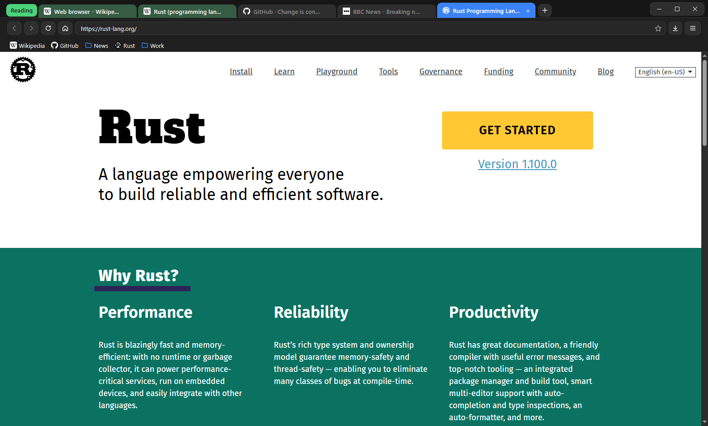

---

## Lo más destacado

- **Diminuto**: un `Suppa.exe` de unos **3 MB**. Sin DLL ni servicios en segundo plano. Usa el pequeño instalador opcional o simplemente ejecuta el exe.
- **Rápido**: la ventana y la barra están listas en unos **0,2 s**; el bloqueador de anuncios, en **25 ms**.
- **Ligero con la CPU y la RAM**: las pestañas en segundo plano se suspenden y descargan solas; en reposo, cerca del **0,1 % de un núcleo**.
- **Privado**: sin cuenta, sin telemetría, sin analítica. Suppa nunca envía nada sobre ti a ninguna parte (detalles abajo).
- **Bloqueador de anuncios y rastreadores integrado**: el motor de Brave con EasyList, EasyPrivacy, filtros y arreglos rápidos de uBlock, listas para avisos de cookies y tus propias reglas.
- **Anuncios de YouTube saltados**: los que se cuelan se silencian, se adelantan hasta el final y se pulsa su botón **Omitir** por ti (con un clic real, que YouTube acepta); los espacios publicitarios del feed y junto a los vídeos se ocultan.
- **Avisos de cookies resueltos**: por defecto **solo las cookies necesarias** («Rechazar todo»), o «Aceptar todo» si lo prefieres (Ajustes → Privacidad; se puede desactivar).
- **Direcciones, tarjetas y PayPal**: guarda varias direcciones, tarjetas de pago y cuentas de PayPal (en Ajustes o desde un formulario que envíes) y rellénalas con un clic; las tarjetas piden antes Windows Hello y los códigos de seguridad nunca se guardan.
- **Contraseñas seguras**: los formularios de registro reciben una contraseña generada como `A%$3G&8^ga12Kq` que Suppa rellena y guarda para ese sitio.
- **Sincronizar y compartir con Dropbox** (opcional): contraseñas, direcciones y tarjetas en un archivo cifrado con tu frase de contraseña, a través de la app de Dropbox; cada PC o persona con la misma carpeta y la misma frase las obtiene.
- **Reproductor y volumen por pestaña**: un botón de reproductor junto a las descargas muestra lo que suena (portada del álbum de Spotify / Tidal, una pequeña vista previa del vídeo de YouTube) con reproducir / pausa, siguiente y un control de volumen para cada pestaña, independiente del volumen de Windows. Las pestañas muestran un altavoz: un clic las silencia.
- **Guardar vídeo / MP3**: clic derecho en un vídeo (o en una página de YouTube) para guardarlo, o solo su sonido como MP3.
- **Mantener una pestaña activa**: las pestañas que elijas nunca se suspenden en segundo plano.
- **Extensiones de Chrome**: instálalas desde la Chrome Web Store con **Add to Suppa**, con botones y ventanas emergentes junto a la barra de direcciones.
- **Grupos de pestañas**: arrastra una pestaña sobre otra y mantenla: forman un grupo de color que se puede plegar.
- **Barra de pestañas guardadas** con carpetas y arrastrar y soltar; una ☆ guarda un sitio con un clic.
- **Tu diseño**: pestañas, barra de direcciones y pestañas guardadas donde quieras: arriba, abajo o en una columna a la izquierda/derecha (p. ej. la barra de direcciones arriba y las pestañas y guardadas a la izquierda).
- **Tu idioma**: inglés, ruso, alemán, español o chino (por defecto el idioma de Windows; Ajustes → Apariencia → Idioma).
- **Tu aspecto**: temas más oscuro / oscuro / claro / más claro, un tinte sobre toda la interfaz, cualquier color de acento (o el de Windows), cualquier color de la interfaz, esquinas redondas o squircle, qué esquinas de las pestañas se redondean, cinco estilos de iconos, escala de la interfaz.
- **Pestañas de incógnito**, ordenar pestañas, sacar una pestaña a una ventana nueva, recuperación tras un fallo, copia de seguridad y restauración, importación de marcadores.
- **Gestor de contraseñas**: ver, buscar, copiar y eliminar contraseñas guardadas (antes se pide Windows Hello o tu contraseña de Windows); importarlas desde Firefox, Chrome, Edge o Brave y exportarlas a un archivo `.csv`.
- **Historial, descargas y accesos directos**: una página de historial con búsqueda, un botón de descargas junto a la barra de direcciones que se llena con tu color de acento mientras descarga, y tus sitios más visitados con sus iconos en una página de inicio con tu tema.
- **Iconos de sitios acordes a tu tema**: en pestañas, pestañas guardadas, historial y página de inicio; los iconos blancos se oscurecen en el tema claro y los negros se aclaran en el oscuro.
- **Se actualiza solo**: consulta GitHub una vez al día; instalado con el instalador, se actualiza con un clic y muestra las novedades.
- **Modificable**: toda la interfaz es HTML/CSS/JS sencillo en una carpeta junto al exe; edítala y pulsa **Update**.

---

## Capturas de pantalla

| | |
|---|---|
|  | 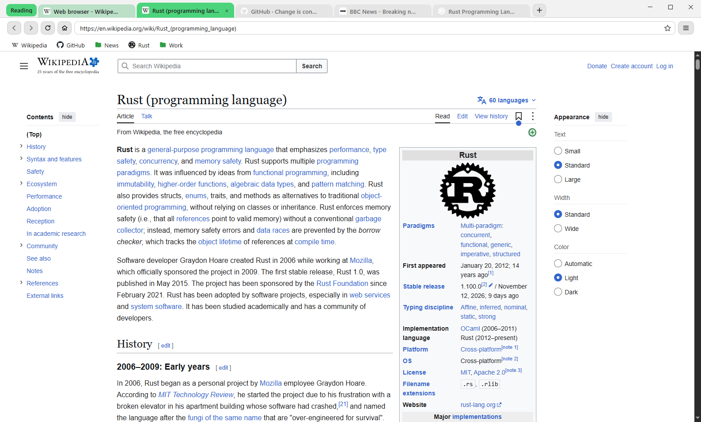 |
| **Tema oscuro** (acento azul): grupo de pestañas «Reading», barra de pestañas guardadas, botón de descargas junto a la barra de direcciones | **Tema claro** (acento índigo): los iconos de los sitios se adaptan al tema |
| 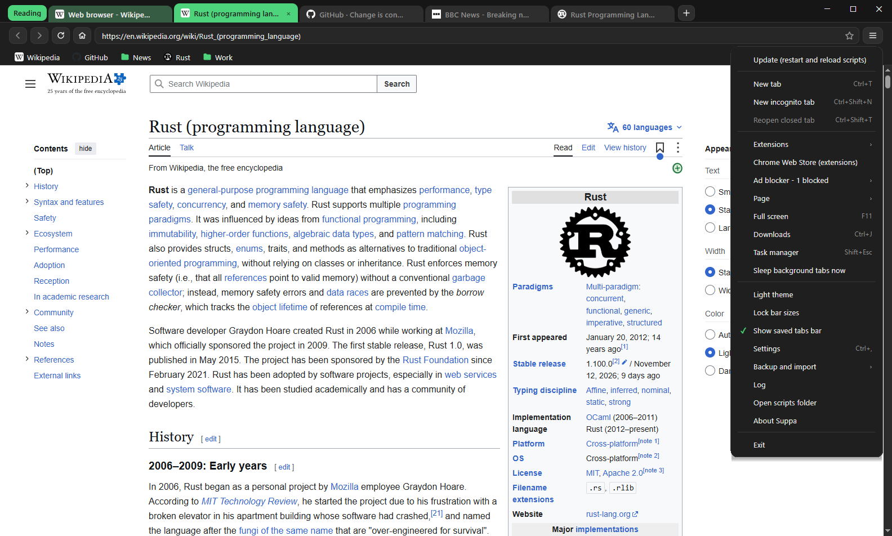 | 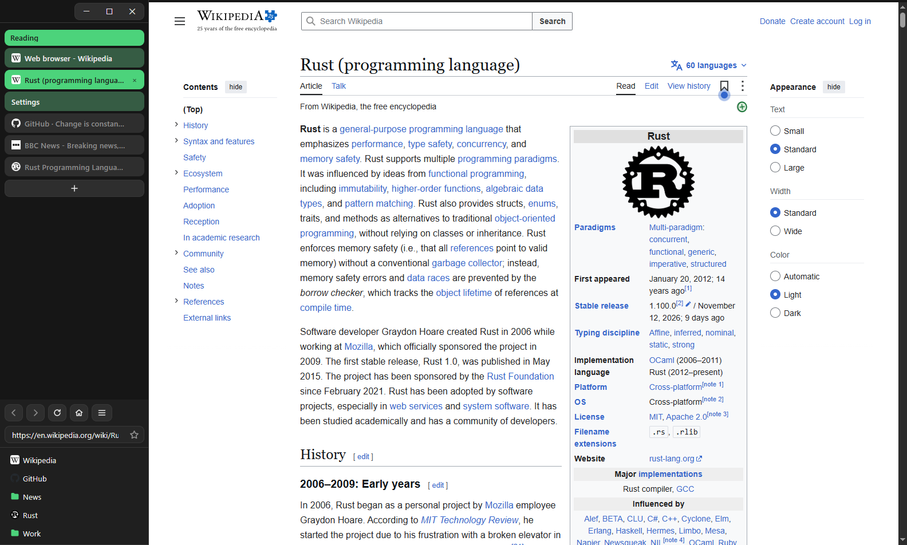 |
| **El menú ≡** (acento naranja): todos los menús siguen el tema del navegador | **Barra a la izquierda** (acento lima): pestañas verticales, dirección y pestañas guardadas en una columna |
| 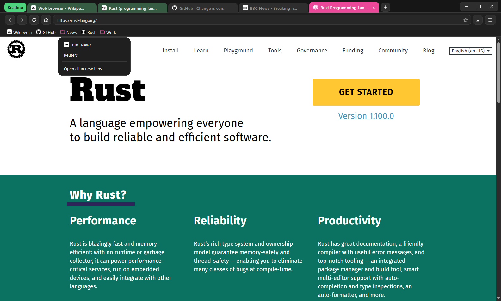 | 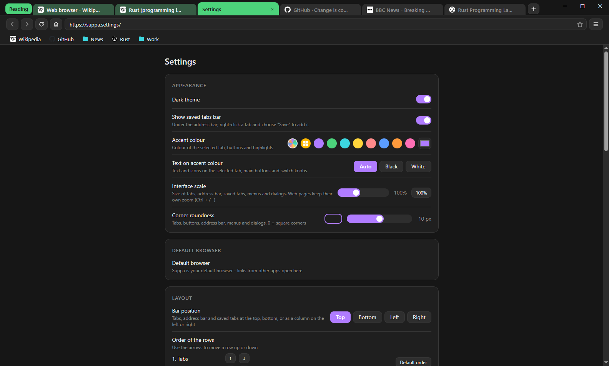 |
| **Pestañas guardadas** (acento rosa): las carpetas se abren como menús; arrastra para ordenar | **Ajustes** (acento amarillo): agrupados en secciones a la izquierda: aspecto, esquinas, diseño, privacidad, contraseñas, copia de seguridad, actualizaciones |
| 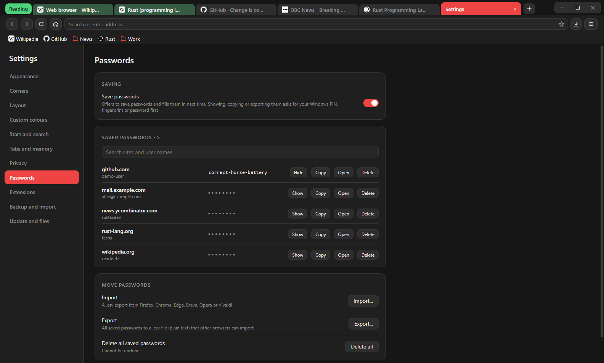 | 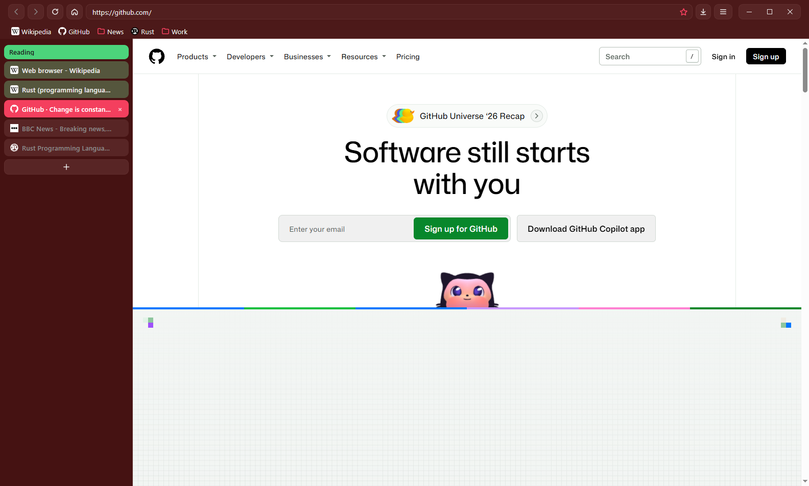 |
| **Gestor de contraseñas** (acento rojo, entradas de ejemplo): buscar, mostrar, copiar, eliminar; importar desde Firefox, Chrome, Edge o Brave y exportar a `.csv` | **Tu diseño y tu aspecto** (acento rosado): pestañas a la izquierda, barra de direcciones arriba, tema oscuro con un 20 % de tinte rojo |
| 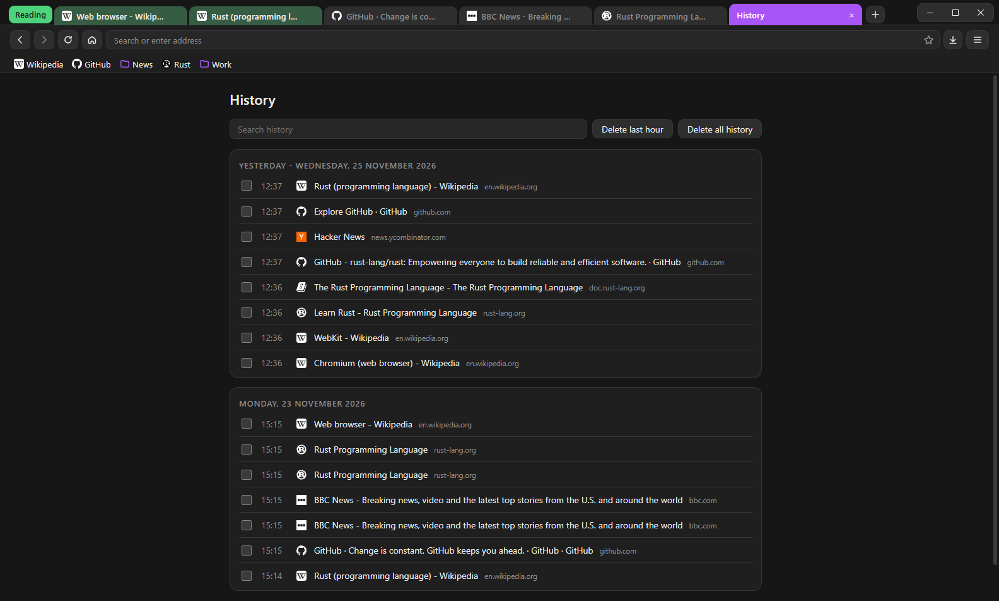 | 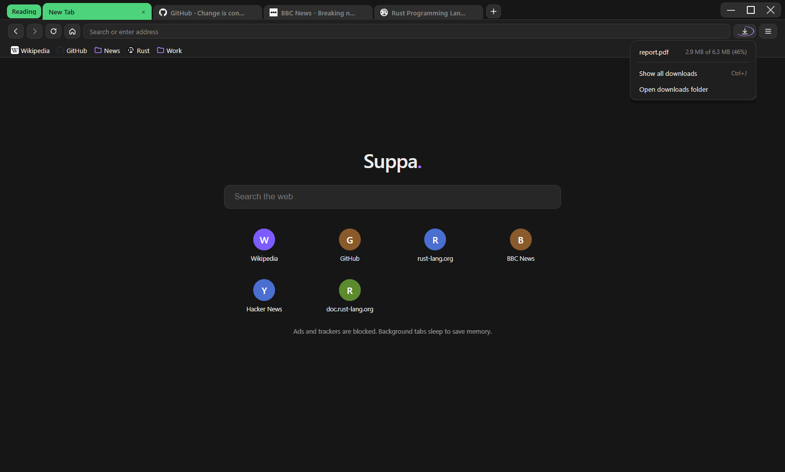 |
| **Historial** (`Ctrl+H`, acento morado): agrupado por días, con iconos de sitios y búsqueda | **Página de inicio** (acento verde azulado): tus sitios más visitados con sus iconos y una descarga llenando el botón de descargas |

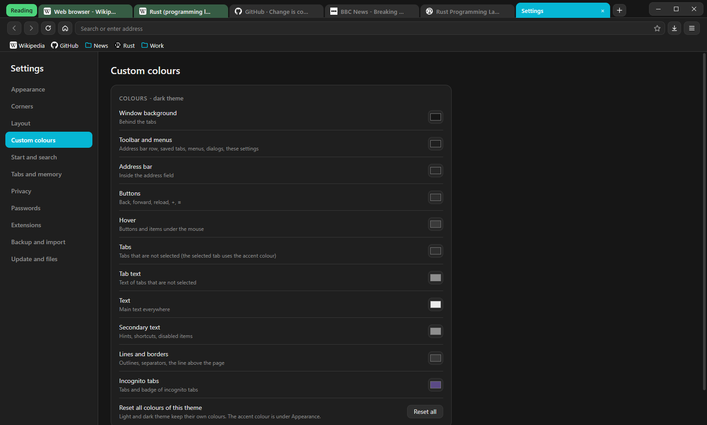
*Ajustes → Colores personalizados (acento cian): cambia cualquier color de la interfaz (por separado para el tema claro y el oscuro).*

---

## Velocidad y memoria

Medido en Windows 10 (WebView2 157), Suppa 0.4, una página abierta, 60 s después del inicio:

| | |
|---|---|
| Tamaño del programa | **3,0 MB** (`Suppa.exe`, todo incluido) |
| Ventana + barra listas | **~0,19 s** tras el inicio |
| Bloqueador de anuncios listo | **25 ms** tras el inicio (motor de filtros en caché, 1-2 ms en el hilo de la interfaz) |
| CPU en reposo | **63 ms de CPU por minuto** para todos los procesos de Suppa juntos (≈ **0,1 %** de un núcleo) |
| Memoria del propio `Suppa.exe` | **13 MB** |
| Navegador completo (todos los procesos del motor, 1 página) | **~270 MB** de memoria privada, 8 procesos |

Por qué se mantiene ligero:

- **Pestañas dormidas**: las pestañas que no has mirado en 5 minutos se congelan (0 % de CPU); a los 30 minutos se descargan y liberan su memoria. Al hacer clic en la pestaña se vuelve a cargar. Las pestañas que reproducen sonido y las que mantienes activas nunca se suspenden. (Los tiempos se cambian en Ajustes.)
- **Restauración diferida**: las pestañas de tu última sesión solo se cargan cuando haces clic en ellas.
- **Procesos compartidos**: las pestañas del mismo sitio comparten un proceso de renderizado; la barra y los menús comparten otro.
- **Nada en segundo plano**: los cambios de archivos se detectan con notificaciones de Windows en lugar de sondeos; una ventana minimizada no dibuja nada.
- **Dibujo rápido**: las páginas se dibujan con 4 hilos de rasterizado y en la tarjeta gráfica; las descargas grandes usan varias conexiones.

La mayor parte de la memoria es del propio motor Chromium (renderizado de páginas, proceso de GPU, red). Suppa añade unos 13 MB.

---

## Privacidad

**Suppa no recopila ningún dato.** En el código de Suppa no hay cuenta, telemetría, analítica, informes de fallos ni «llamadas a casa». Todo se queda en tu PC, en `%LOCALAPPDATA%\SuppaBrowser`.

Las únicas conexiones que hace Suppa por sí mismo:

| Cuándo | A dónde | Para qué |
|---|---|---|
| Al primer inicio y luego cada 4 días | easylist.to, ublockorigin.github.io, secure.fanboy.co.nz, raw.githubusercontent.com | descargar las listas de filtros de anuncios |
| Solo cuando pulsas **Add to Suppa** | clients2.google.com | descargar esa extensión de la Chrome Web Store |
| Una vez al día (se desactiva en Ajustes → Actualizaciones y archivos) y cuando pulsas **Buscar actualizaciones** | api.github.com, github.com | leer el número de la versión más reciente y sus notas; descargar la actualización cuando pulsas **Actualizar ahora** |
| Lo que escribes en la barra de direcciones | el buscador que elegiste (Google, DuckDuckGo, Bing, Brave) | tu búsqueda |
| Solo la primera vez que usas **Guardar vídeo / MP3** (se te pregunta antes) y luego, como mucho una vez por semana al guardar algo, una comprobación de actualizaciones de yt-dlp | github.com | descargar yt-dlp y FFmpeg en la carpeta de datos de Suppa (`tools\`) |

**La sincronización con Dropbox** (desactivada hasta que la actives) no hace ninguna conexión por sí misma: Suppa escribe un archivo en tu carpeta de Dropbox y la app de Dropbox lo sincroniza. El archivo está cifrado con tu frase de contraseña (PBKDF2-SHA256 + AES-256-GCM), así que Dropbox no puede leerlo.

Privacidad extra integrada: se bloquean anuncios y rastreadores, las peticiones de seguimiento `<a ping>` están desactivadas, los extras de Edge (compras, traductor, SmartScreen) están desactivados y las pestañas de incógnito no guardan nada al cerrarse.

*Las páginas web las muestra el runtime WebView2 de Microsoft (parte de Windows). Como cualquier componente de Windows, sigue la configuración de datos de diagnóstico de Windows (Configuración → Privacidad → Diagnóstico y comentarios): eso es entre Windows y Microsoft, no Suppa.*

---

## Funciones

### Pestañas
- **Nueva / cerrar / reabrir**: `Ctrl+T` (o `Ctrl+N`), `Ctrl+W` o clic central; `Ctrl+Shift+T` reabre la última pestaña cerrada en su sitio.
- **Ordenar**: arrastra una pestaña a izquierda/derecha y las demás se apartan. Animaciones suaves; las pestañas solo se estrechan cuando la fila está llena.
- **Grupos de pestañas**: arrastra una pestaña y **mantenla sobre el centro de otra** → forman un grupo (o la pestaña se une al grupo de la otra). Cada grupo tiene una etiqueta de color: clic para plegar/desplegar, clic derecho para renombrar, cambiar el color, desagrupar o cerrar el grupo. Las pestañas agrupadas se tiñen con el color del grupo. Clic derecho en una pestaña → *Añadir a un grupo nuevo / Quitar del grupo / Desagrupar*. Los grupos se guardan con la sesión.
- **Ventana nueva**: arrastra una pestaña fuera de la ventana y suéltala: se abre en una ventana nueva (con las mismas sesiones y extensiones).
- **Incógnito**: `Ctrl+Shift+N`, un perfil privado aparte; no se guarda nada.
- **Recuperación tras un fallo**: las pestañas abiertas y los grupos se guardan 2 segundos después de cada cambio y siempre vuelven tras un fallo.

### Pestañas guardadas (marcadores)
- La ☆ al final de la barra de direcciones guarda el sitio actual (★ = guardado, otro clic lo quita), o clic derecho en una pestaña → *Guardar*.
- Arrastra para ordenar. Suelta un elemento sobre el centro de otro → una carpeta con ambos. Suelta sobre una carpeta → entra en ella. Arrastra un enlace de una carpeta abierta a la barra para sacarlo.
- Clic derecho para *Abrir en pestaña nueva / de incógnito, Renombrar, Eliminar, Carpeta nueva*.

### Bloqueador de anuncios y avisos de cookies
- Bloqueo de red, ocultación cosmética y scriptlets antianuncios (motor `adblock-rust` de Brave).
- ≡ → *Bloqueador de anuncios*: cuántas peticiones se bloquearon, permitir anuncios en un sitio, actualizar listas.
- Tus propias reglas: `scripts\filters\*.txt` (sintaxis de uBlock / AdBlock).
- Los avisos de cookies se responden automáticamente (en muchos idiomas): por defecto **solo las necesarias** («Rechazar todo» / «Solo necesarias», o la × del aviso si no tiene ese botón), o **aceptar todo**: Ajustes → Privacidad. Allí también se desactiva.
- YouTube: los anuncios de vídeo se silencian, se adelantan al final y se pulsa el botón **Omitir** con un clic de ratón real (de confianza), así que nunca tienes que pulsarlo tú.

### Direcciones, pagos y contraseñas
- **Ajustes → Direcciones y pagos**: añade tantas direcciones (Casa, Trabajo...), tarjetas de pago y cuentas de PayPal como quieras, o deja que Suppa ofrezca guardarlas cuando envías un formulario. Todo se cifra para tu cuenta de Windows (`vault.dat`).
- En los formularios web aparece un pequeño **botón de llave** en los campos de dirección, tarjeta, PayPal y contraseña. Abre el menú propio de Suppa (la página nunca ve lo que guardaste) y rellena solo lo que elijas. Las tarjetas se rellenan tras Windows Hello; el código de seguridad (CVC) nunca se guarda. Si una tienda también acepta PayPal, el menú incluye **Pagar con PayPal**; en la página de acceso de PayPal rellena tu correo de PayPal.
- **Contraseñas seguras**: en un formulario de registro, el botón de llave ofrece una contraseña generada (mayúsculas y minúsculas, cifras, símbolos). Suppa la escribe en ambos campos de contraseña, la guarda para el sitio y la añade al almacén de contraseñas del propio navegador en el siguiente inicio. Ajustes → Contraseñas también tiene un generador (`Ctrl+Shift+G` copia una).
- **Sincronizar y compartir con Dropbox** (Ajustes → Contraseñas, desactivado por defecto): un archivo en `Dropbox\Apps\Suppa`, cifrado con tu frase de contraseña. Cada PC con la misma frase (y cada persona con quien compartas esa carpeta de Dropbox) obtiene las mismas contraseñas, direcciones y tarjetas; los cambios se combinan por entrada y las eliminaciones se transmiten. En su lugar se puede elegir cualquier otra carpeta sincronizada (OneDrive, una memoria USB).

### Multimedia
- **Botón del reproductor** junto al botón de descargas (≡ → Aspecto y barra → Mostrar el botón del reproductor) mientras una pestaña reproduce: portada del álbum (Spotify, Tidal, SoundCloud, YouTube Music...) o una pequeña vista previa en vivo del vídeo (YouTube y la mayoría de sitios de vídeo), reproducir / pausa, anterior / siguiente, silenciar y un **control de volumen solo para esa pestaña**; el volumen de Windows no cambia. Clic en el título para ir a la pestaña. `Ctrl+Shift+M` lo abre.
- Las pestañas que reproducen muestran un **altavoz** (clic = silenciar, `Ctrl+M`); clic derecho en una pestaña → **Sonido** para silenciar y volumen al 100 / 75 / 50 / 25 / 10 %.
- **Guardar vídeo / MP3**: clic derecho en un vídeo o audio (o en cualquier parte de una página de YouTube, Vimeo, SoundCloud...), el reproductor o ≡ → Esta página. Los archivos de vídeo normales se descargan directamente; los sitios de streaming y los MP3 usan los programas gratuitos yt-dlp y FFmpeg, que Suppa descarga una vez después de preguntar. Los archivos van a tu carpeta de Descargas. (Guarda solo lo que tengas permitido.)
- **Mantener activa**: clic derecho en una pestaña → *Mantener activa* (o ≡ → Esta página): nunca se congela ni se descarga en segundo plano (aparece un pequeño sol en la pestaña).

### Extensiones
- Abre una extensión en la Chrome Web Store y pulsa **Add to Suppa** (Suppa la descarga e instala él mismo).
- Los botones de las extensiones aparecen a la derecha de la barra de direcciones: clic = ventana emergente de la extensión bajo el botón, clic derecho = opciones / ocultar / quitar.
- ≡ → *Extensiones* las muestra todas (activar/desactivar, opciones, mostrar en la barra, quitar) y puede cargar una carpeta descomprimida.

### Aspecto y diseño (Ajustes)
- **Idioma**: English, Русский, Deutsch, Español o 中文: menús, Ajustes, la barra y las páginas de Suppa. *Automático* (por defecto) usa el idioma de Windows, o inglés si Suppa no lo tiene. Las traducciones están en `scripts\lang.json`.
- **Tema**: **Sistema** (claro u oscuro como Windows, por defecto), más oscuro (negro), oscuro, claro, más claro (blanco); **tinte**: cualquier color sobre toda la interfaz, 0-60 % (p. ej. oscuro con un 20 % de rojo). Color de acento: arcoíris por pestaña, 8 predefinidos, cualquier color o **el color de acento de Windows** (por defecto); texto sobre el acento: auto / negro / blanco.
- **Escala de la interfaz** 75–150 % (las páginas mantienen su propio zoom), **redondez de las esquinas** 0–20 px, **estilo de esquinas** redondas o **squircle** (esquinas suaves de superelipse en todas partes, menús incluidos).
- **Esquinas de las pestañas**: elige cuáles de las cuatro esquinas de una pestaña se redondean (o Auto).
- **Estilo de iconos**: Línea, Grueso, Nítido, Relleno o Bitono (barra, pestañas guardadas, botones de ventana).
- **Ajustes → Colores personalizados**: cualquier color de la interfaz, por tema.
- **Diseño**: cada fila (pestañas, barra de direcciones, pestañas guardadas) **arriba, abajo, a la izquierda o a la derecha**, o todas a la vez; las filas de la izquierda/derecha comparten una columna con pestañas verticales (arrastra su borde para cambiar el ancho). Las filas del mismo borde siguen el **orden** elegido. Si no hay ninguna fila arriba, los botones de ventana flotan sobre la esquina superior derecha de la página.
- Arrastra la línea fina bajo una fila para cambiar su altura; ≡ → *Bloquear tamaños de las barras* evita accidentes.
- La ventana no tiene barra de título de Windows: la fila de pestañas *es* la barra de título (arrastra para mover, doble clic para maximizar).

### Contraseñas, copia de seguridad e importación
- Las contraseñas y los datos de formularios se guardan y se rellenan (se puede desactivar).
- **Gestor de contraseñas**: Ajustes → Contraseñas muestra todas las contraseñas guardadas con búsqueda, Mostrar, Copiar, Abrir y Eliminar (la eliminación se aplica al reiniciar Suppa; el motor mantiene bloqueado su almacén mientras funciona). **Exportar** las escribe todas en un archivo `.csv` que otros navegadores pueden importar. Mostrar, Copiar y Exportar piden antes a Windows que confirme quién eres (**Windows Hello**: PIN, huella o cara, o tu contraseña de Windows); una comprobación vale un minuto.
- **Copia de seguridad**: un `.zip` con ajustes, tamaños de barras, pestañas guardadas y abiertas, scripts, extensiones, contraseñas guardadas, datos de formularios e inicios de sesión de sitios. **Restaurar** la aplica en el siguiente inicio. (Windows cifra las contraseñas para tu cuenta, así que se restauran en la misma cuenta de Windows.)
- **Importar marcadores** desde Chrome, Edge, Brave, Vivaldi, Opera o Firefox (se encuentran automáticamente) o desde un archivo de marcadores `.html` exportado.
- **Importar contraseñas** desde una exportación de contraseñas de Firefox, Chrome, Edge o Brave (`.csv`): Ajustes → Contraseñas → Importar, o ≡ → Copia de seguridad e importación → Importar contraseñas desde un archivo. En Brave: brave://password-manager/settings → Export passwords. En Firefox: about:logins → ⋯ → Exportar inicios de sesión. Las contraseñas se cifran al momento para tu cuenta de Windows y pasan al almacén de Suppa al reiniciar; después Suppa ofrece eliminar el archivo exportado (contiene las contraseñas en texto sin cifrar).

### Historial y descargas
- **Historial** (`Ctrl+H`, ≡ → Historial): cada página abierta en una pestaña normal, agrupada por días, con búsqueda; elimina páginas sueltas, la última hora o todo. El primer inicio copia el historial que ya tenía el motor. Las pestañas de incógnito nunca se registran.
- **Accesos directos de la página de inicio**: la página de inicio de Suppa muestra tus 8 sitios más visitados de los últimos 90 días con los iconos de sus pestañas (una letra de color si el sitio no tiene); la × quita uno. La página de inicio usa tu tema y tu color de acento y muestra la versión de Suppa. Las pestañas guardadas y el historial muestran los mismos iconos, así que los marcadores importados obtienen el suyo en cuanto visitas el sitio.
- **Descargas**: adiós a la ventana de descargas de Edge. Cuando empieza una descarga se abre una ventana emergente con su progreso, y el botón de descargas junto a la barra de direcciones se llena con el color de acento en el sentido de las agujas del reloj (se oculta en ≡ → Mostrar el botón de descargas). Clic = abrir / pausar / reanudar, clic derecho = Mostrar en la carpeta, Cancelar, Volver a descargar, Quitar. La **página de descargas** (`Ctrl+J`) muestra todas las descargas con búsqueda, Abrir, Mostrar en la carpeta, Pausar / Reanudar y Cancelar.

### Actualizaciones
- Una vez al día Suppa pregunta a GitHub por la versión más reciente (solo el número de versión; se desactiva en Ajustes → Actualizaciones y archivos). ≡ → **Buscar actualizaciones** pregunta al momento.
- Instalado con el instalador: **Actualizar ahora** descarga el nuevo `SuppaSetup.exe` y lo ejecuta en silencio; Suppa se cierra, se actualiza y se vuelve a abrir con tus pestañas. Una copia portable abre en su lugar la página de descargas.
- Tras una actualización, **Novedades** muestra las notas de esa versión desde GitHub (también en Ajustes → Actualizaciones y archivos).

### Todo lo demás
- Menús con el tema del navegador en todas partes (≡, pestañas, pestañas guardadas, clic derecho en páginas) y diálogos a juego. Clic derecho en una página → **Inspeccionar** abre las herramientas para desarrolladores en ese elemento.
- Haz de Suppa tu **navegador predeterminado** (en Ajustes o con la pregunta del primer inicio).
- Recuerda el tamaño y la posición de la ventana; pantalla completa (`F11`), imprimir, herramientas para desarrolladores, administrador de tareas.
- Tus propios scripts de usuario: `scripts\userscripts\*.js` (con patrones `// @match`).

---

## Atajos de teclado

Las mismas teclas que en Chrome, Edge y Firefox. `F1` (≡ → Ayuda y actualizaciones → Atajos de teclado) los muestra todos en Suppa.

| Teclas | Acción |
|---|---|
| `Ctrl+T` / `Ctrl+N` | Nueva pestaña |
| `Ctrl+Shift+N` | Nueva pestaña de incógnito |
| `Ctrl+W`, `Ctrl+F4` / `Ctrl+Shift+W` | Cerrar pestaña / cerrar la ventana |
| `Ctrl+Shift+T` | Reabrir pestaña cerrada |
| `Ctrl+Tab`, `Ctrl+AvPág` / `Ctrl+Shift+Tab`, `Ctrl+RePág` | Pestaña siguiente / anterior |
| `Ctrl+Shift+RePág` / `Ctrl+Shift+AvPág` | Mover la pestaña a la izquierda / derecha |
| `Ctrl+1` … `Ctrl+9` | Ir a la pestaña 1…8 / a la última |
| `Ctrl+M` | Silenciar / activar el sonido de la pestaña |
| `Ctrl+L`, `Alt+D`, `F6`, `Ctrl+E`, `Ctrl+K` | Barra de direcciones (`Ctrl+Enter` convierte `nombre` en `www.nombre.com`) |
| `F5`, `Ctrl+R` / `Ctrl+F5`, `Ctrl+Shift+R` | Recargar / recargar sin caché |
| `Alt+Izquierda` / `Alt+Derecha` / `Alt+Inicio` | Atrás / adelante / página de inicio |
| `Ctrl+D` / `Ctrl+Shift+B` | Guardar la página en la barra de pestañas guardadas / mostrar u ocultar esa barra |
| `Ctrl++` / `Ctrl+-` / `Ctrl+0` | Acercar / alejar / restablecer zoom |
| `Alt+S`, `Ctrl+,` | Ajustes |
| `Alt+F`, `Alt+E`, `F10` | Abrir el menú ≡ |
| `F11` | Pantalla completa |
| `Ctrl+H` / `Ctrl+J` / `Shift+Esc` | Historial / descargas / administrador de tareas |
| `Ctrl+Shift+M` / `Ctrl+Shift+G` | Reproductor / copiar una contraseña segura nueva |
| `Ctrl+O` / `Ctrl+U` | Abrir un archivo / código fuente de la página |
| `Ctrl+Shift+Supr` | Borrar datos de navegación |
| `Ctrl+P`, `Ctrl+F`, `F12`, `Ctrl+Shift+I` | Imprimir, buscar, herramientas para desarrolladores |
| `F1` | Lista de atajos |

`Ctrl+D`, `Ctrl+E`, `Ctrl+K`, `Ctrl+M` y `Ctrl+U` llegan primero a la página, como en Chrome: un editor que los usa (un enlace con `Ctrl+K`, subrayado con `Ctrl+U`) los conserva.

---

## Instalación

**Requisitos:** Windows 10 u 11 (64 bits) con Microsoft Edge WebView2 Runtime (ya incluido en Windows 10/11 actualizado).

**Instalador (recomendado):** descarga **`SuppaSetup.exe`** de la página [Releases](../../releases) y ejecútalo.
- Instala solo para tu cuenta de Windows, sin permisos de administrador, en `%LOCALAPPDATA%\Programs\Suppa`.
- Añade accesos directos en el menú Inicio y el escritorio y una entrada en **Configuración de Windows → Aplicaciones**, desde donde puedes desinstalarlo.
- Si falta WebView2 Runtime, ofrece descargarlo e instalarlo desde Microsoft.
- Suppa se actualiza solo (Ajustes → Actualizaciones y archivos), o ejecuta un `SuppaSetup.exe` más reciente: se conservan tus pestañas, ajustes, reglas de filtros propias y scripts de usuario.
- La ventana del instalador sigue tu tema de Suppa, tu color de acento y la redondez de las esquinas.
- Uso silencioso: `SuppaSetup.exe /S` instala, `SuppaSetup.exe --uninstall /S` desinstala (tus datos se conservan).

**Portable:** descarga el `.zip` de la página [Releases](../../releases), descomprímelo donde quieras y ejecuta `Suppa.exe`.

**Compílalo tú mismo:** haz doble clic en **`build.bat`**. Instala lo que falte (Rust, las Microsoft C++ Build Tools, el runtime WebView2) y luego genera `dist\Suppa.exe` (con la carpeta `scripts` al lado) y `dist\SuppaSetup.exe`.

**Firma de código (opcional):** con un certificado de firma de código, `build.bat` firma `Suppa.exe` y `SuppaSetup.exe` para que Windows SmartScreen confíe en ellos. Antes de ejecutarlo, define una de estas variables en tu entorno (nunca en un archivo del proyecto): `SUPPA_SIGN_THUMBPRINT` (un certificado del almacén de certificados de Windows), `SUPPA_SIGN_PFX` + `SUPPA_SIGN_PASSWORD` (un archivo `.pfx`) o `SUPPA_SIGN_ARGS` (tus propios argumentos de `signtool`, p. ej. para Azure Trusted Signing). Necesita `signtool.exe` del Windows SDK. Sin ellas, la compilación queda sin firmar, como antes.

### Linux

Suppa para Linux es el mismo navegador sobre **GTK + WebKitGTK** (el motor de GNOME Web) en lugar de WebView2. Usa la misma carpeta `scripts`, así que la barra, los menús, Ajustes, temas, diseños, pestañas guardadas, grupos de pestañas, bloqueador de anuncios, avisos de cookies, pestañas de incógnito, recuperación tras fallos y el botón Update funcionan igual.

**Requisitos:** un escritorio Linux de 64 bits con WebKitGTK 4.1 (preinstalado en la mayoría de escritorios GNOME; si no, `sudo apt install libwebkit2gtk-4.1-0`, `sudo dnf install webkit2gtk4.1` o `sudo pacman -S webkit2gtk-4.1`).

**Descarga:** obtén `Suppa-<version>-linux-x64.tar.gz` de la página [Releases](../../releases), descomprímelo y ejecuta:

```sh
sh install.sh
```

Se instala solo para tu usuario (sin root): el programa en `~/.local/share/suppa-browser`, un comando `suppa` en `~/.local/bin` y una entrada de menú con el icono. `sh install.sh --uninstall` lo elimina; tus ajustes y pestañas se quedan en `~/.local/share/SuppaBrowser`.

**Compílalo tú mismo:** `sh linux/build.sh` instala lo que falte (Rust, los archivos de desarrollo de WebKitGTK) y luego genera `dist/linux/` con `suppa`, `scripts/` e `install.sh`.

Lo que (aún) no tiene la versión para Linux: extensiones de Chrome (WebKitGTK no admite extensiones), contraseñas guardadas y relleno de formularios, páginas de historial y descargas, actualizaciones, copias de seguridad e importación de marcadores, el instalador, la congelación de pestañas en segundo plano (en su lugar se descargan pasado el tiempo fijado) y las novedades de la 0.12 (direcciones y pagos, reproductor, guardar vídeo). En escritorios Wayland, Suppa funciona mediante XWayland para poder colocar sus menús con exactitud.

---

## Personalizar sin recompilar

Todo lo que hay en `scripts\` junto a `Suppa.exe` se puede editar:

| Archivo | Qué controla |
|---|---|
| `ui.html`, `ui.css`, `ui.js` | la barra: pestañas, botones de ventana, barra de direcciones, pestañas guardadas, colores |
| `menu.html` | todos los menús, diálogos y el reproductor emergente |
| `settings.html` | la pestaña de Ajustes (secciones a la izquierda) |
| `lang.json`, `i18n.js` | las traducciones de la interfaz (ruso, alemán, español, chino) |
| `cookies.js` | qué botones de cookies se pulsan |
| `youtube.js` | el saltador de anuncios de YouTube (funciona en youtube.com mientras el bloqueador esté activo allí) |
| `forms.js` | el botón de llave en formularios: direcciones, tarjetas, PayPal, contraseñas |
| `media.js` | los datos del reproductor y el volumen por pestaña |
| `webstore.js` | el ayudante «Add to Suppa» de la Chrome Web Store |
| `newtab.html` | la página de inicio opcional de Suppa (búsqueda y sitios más visitados) |
| `history.html`, `downloads.html` | las páginas de historial y descargas |
| `userscripts\*.js` | tus propios scripts para páginas web |
| `filters\*.txt` | tus propias reglas de bloqueo de anuncios |

Cuando cambia un archivo, el botón **≡** se convierte en **Update ≡**: pulsa Update y Suppa se reinicia con tus cambios (las pestañas vuelven). Si cambias el código Rust de la carpeta del proyecto, Update vuelve a compilar `Suppa.exe` primero.

---

## Estructura del código

| Archivo | Qué hace |
|---|---|
| `src/main.rs` | Punto de entrada y lista de módulos |
| `src/app.rs` | Estado compartido, pestañas, grupos, ID de comandos |
| `src/window.rs` | Ventana principal, bucle de mensajes, comandos, marco, actualizar/reiniciar, recuperación tras fallos |
| `src/ui.rs` | Barra HTML, disposición de la barra y la página (cada fila arriba/abajo/izquierda/derecha), escala, colores del tema y tinte, icono de la ventana |
| `src/winbtn.rs` | Botones de ventana flotando sobre la página cuando no hay ninguna fila arriba |
| `src/tabs.rs` / `src/groups.rs` | Pestañas (abrir, cerrar, ordenar, separar) / grupos de pestañas |
| `src/webview.rs` | Configuración de WebView2, eventos de página, interceptación de peticiones, menús contextuales de páginas |
| `src/adblock.rs` | Listas de filtros, bloqueo de red, CSS cosmético, scriptlets |
| `src/extensions.rs` / `src/extpopup.rs` | Extensiones de Chrome / ventana emergente de extensiones |
| `src/popup.rs` | Menús y diálogos con el tema del navegador |
| `src/saved.rs` | Barra de pestañas guardadas, carpetas, estrella |
| `src/settings.rs` / `src/settings_page.rs` | settings.ini, sesión / la pestaña de Ajustes |
| `src/backup.rs` / `src/import.rs` | Copia de seguridad y restauración / importación de marcadores |
| `src/passwords.rs` / `src/auth.rs` | Gestor de contraseñas: listar, mostrar, copiar, eliminar, importar y exportar (`.csv`) con el almacén cifrado del motor / comprobación con Windows Hello o la contraseña de la cuenta |
| `src/history.rs` / `src/downloads.rs` / `src/pages.rs` | Historial y accesos de la página de inicio / lista y ventana de descargas / páginas de historial y descargas |
| `src/updater.rs` | Actualizaciones desde los releases de GitHub, Novedades |
| `src/sqlite.rs` | El SQLite propio de Windows, para los archivos de contraseñas e historial del motor |
| `src/sleeper.rs` | Suspensión y descarga de pestañas en segundo plano (excepto las mantenidas activas) |
| `src/vault.rs` / `src/sync.rs` | Direcciones, tarjetas, PayPal, contraseñas generadas y relleno de formularios (`scripts/forms.js`) / sincronizar y compartir con Dropbox |
| `src/i18n.rs` | Idioma de la interfaz para menús y diálogos (`scripts/i18n.js` traduce las páginas; ambos usan `scripts/lang.json`) |
| `src/media.rs` / `src/savemedia.rs` | Botón y ventana del reproductor, volumen por pestaña (`scripts/media.js`) / guardar vídeo y MP3 |
| `src/scripts.rs` | La carpeta scripts, detección de cambios, recompilación |
| `src/default_browser.rs`, `src/shortcuts.rs`, `src/menu.rs`, `src/util.rs` | Navegador predeterminado, atajos, menú ≡, utilidades |
| `build.rs` | Incrusta el manifiesto y dibuja el icono desde `assets/icon.svg`: blanco sobre fondo transparente para un tema oscuro de Windows y negro para uno claro (Suppa cambia con Windows) |
| `installer/` | `SuppaSetup.exe`: instalar, actualizar y desinstalar, en una ventana con el estilo de Suppa |
| `linux/` | Suppa para Linux (GTK + WebKitGTK): los mismos scripts, el mismo código de ajustes (`src/settings.rs`), su propia ventana, pestañas, menús y código del bloqueador; `linux/build.sh`, `linux/install.sh` |
| `.github/workflows/release.yml` | Compila `SuppaSetup.exe`, el zip y el tar.gz en GitHub y publica el release |

---

## Limitaciones conocidas

- La versión para Linux tiene menos funciones que la de Windows (ver [Linux](#linux)).
- La mayoría de extensiones de Chrome funcionan; algunas que necesitan API exclusivas de Chrome pueden no cargar.
- Las contraseñas se importan desde la exportación `.csv` del otro navegador, no se leen directamente de sus archivos (Chrome y Edge los bloquean para sí mismos).

## Licencia

[MIT](LICENSE)
