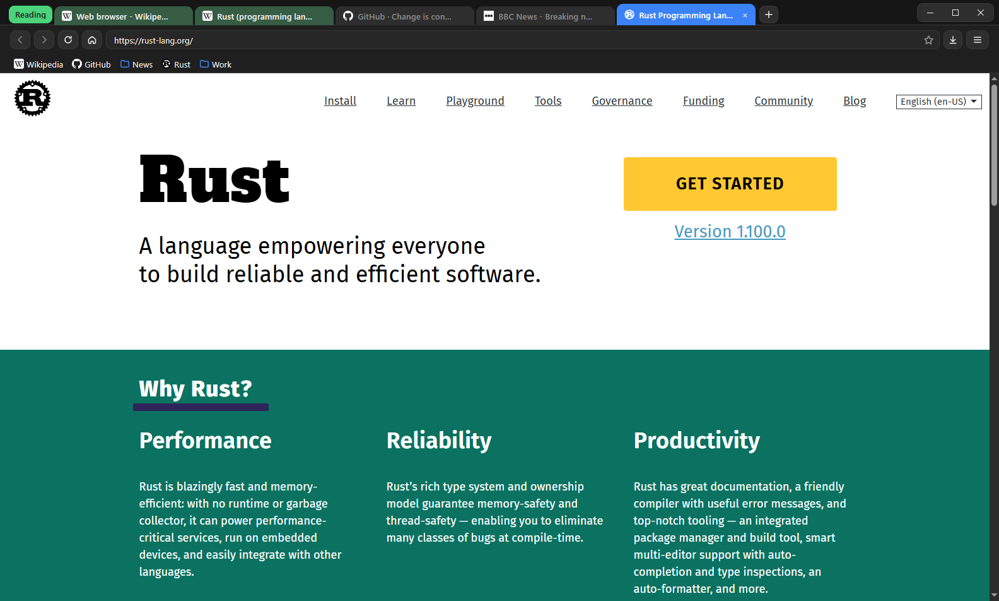
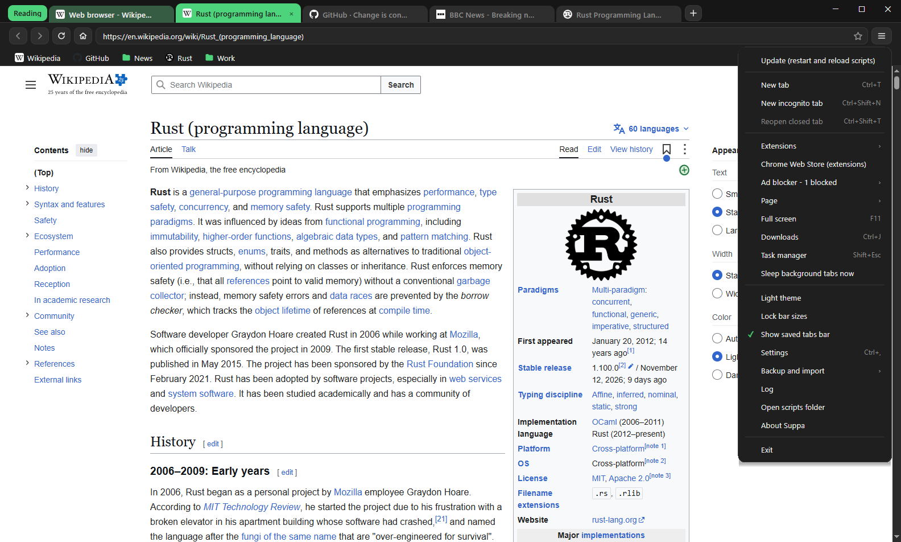
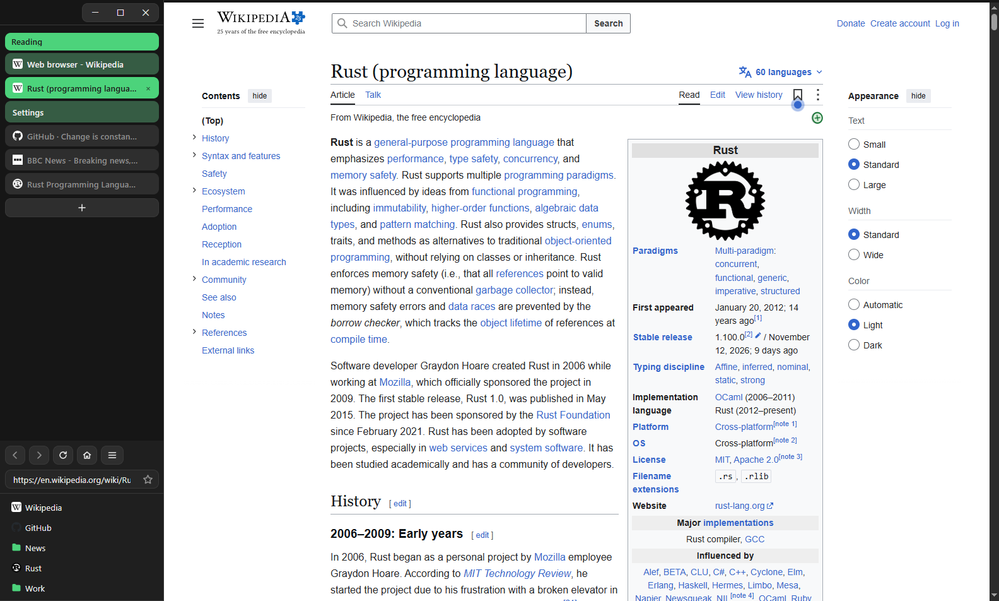
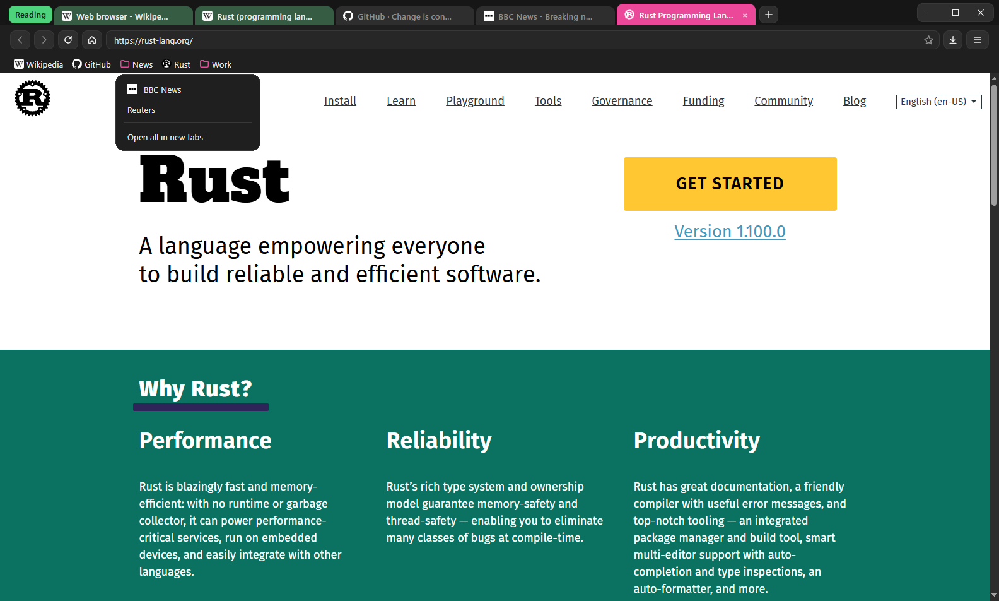
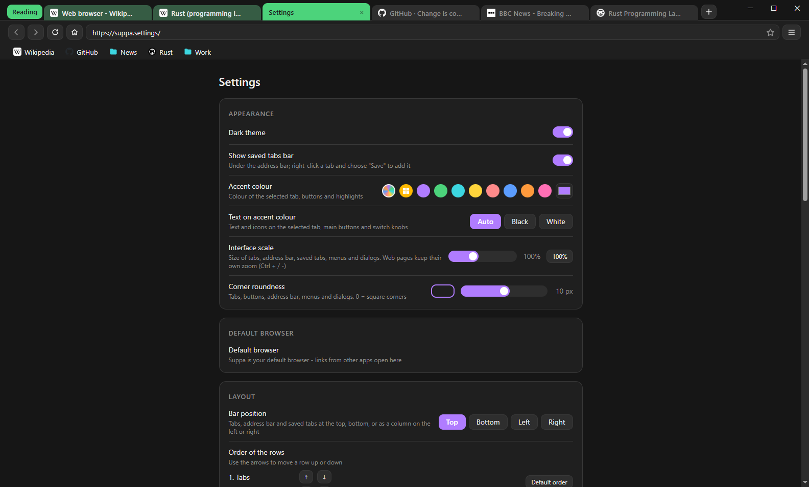
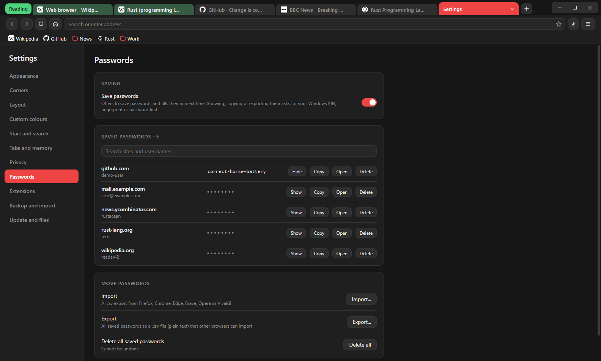
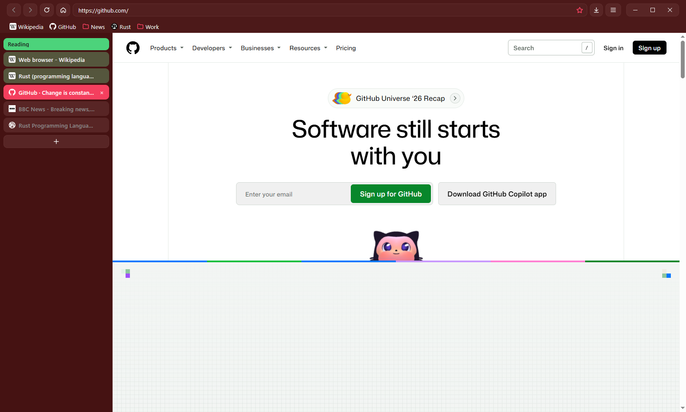
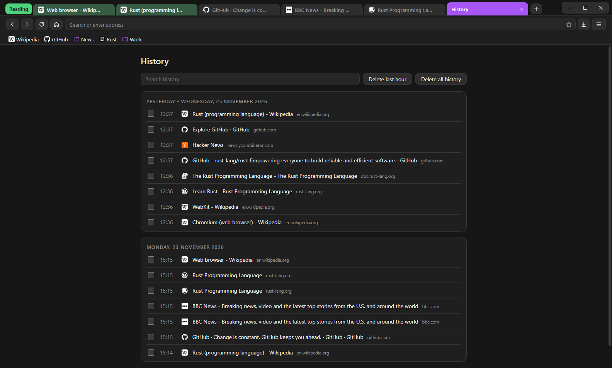
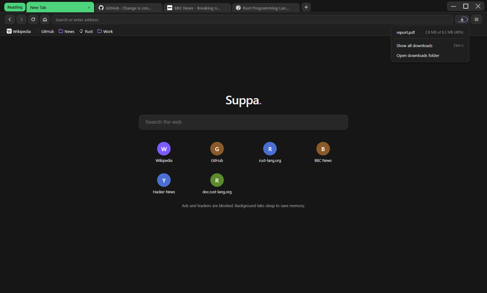
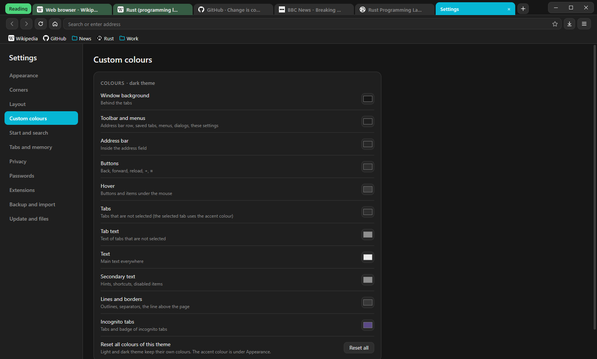

# Suppa Browser

<a href="https://www.buymeacoffee.com/Un1que0ff"></a>

**English** · [Русский](README.ru.md) · [Deutsch](README.de.md) · [Español](README.es.md) · [中文](README.zh.md)

**A tiny, fast, private web browser for Windows (and now Linux) - a single 3 MB `.exe` with a built-in ad blocker, Chrome extensions, tab groups and a fully customisable interface.**

Written in Rust on top of Microsoft **WebView2**, the Chromium engine that is already part of Windows 10/11 - so pages render exactly like in Chrome/Edge, while Suppa itself stays very small.



---

## Highlights

- **Tiny** - one `Suppa.exe` of about **3 MB**. No DLLs, no background services. Use the small optional setup or just run the exe.
- **Fast** - the window and its toolbar are ready in about **0.2 s**; the ad blocker is ready in **25 ms**.
- **Light on CPU and RAM** - background tabs fall asleep and unload automatically; about **0.1 % of one CPU core** when idle.
- **Private** - no account, no telemetry, no analytics. Suppa itself never sends anything about you anywhere (details below).
- **Ad and tracker blocker built in** - Brave's ad-block engine with EasyList, EasyPrivacy, uBlock filters and quick fixes and cookie-banner lists, plus your own rules.
- **YouTube ads skipped** - ads that still get through are muted, jumped to their end and their **Skip** button is pressed for you (with a real click, which YouTube accepts); ad slots in the feed and next to videos are hidden.
- **Cookie popups handled for you** - **only necessary cookies** by default ("Reject all"), or "Accept all" if you prefer (Settings → Privacy; can be turned off).
- **Addresses, cards and PayPal** - save several addresses, payment cards and PayPal accounts (typed in Settings or saved from a form you send) and fill them in with one click; cards need Windows Hello first, security codes are never stored.
- **Strong passwords** - sign-up forms get a generated password like `A%$3G&8^ga12Kq` that Suppa fills in and saves for that site.
- **Sync and share with Dropbox** (optional) - passwords, addresses and cards in one file encrypted with your passphrase, through the Dropbox app; every PC or person with the same folder and passphrase gets them.
- **Player and per-tab volume** - a player button next to the downloads shows what plays (album cover from Spotify / Tidal, a small video preview from YouTube) with play / pause, next, and a volume slider for each tab, independent of the Windows volume. Tabs show a speaker you can click to mute.
- **Save video / Save as MP3** - right-click a video (or a YouTube page) and save it, or just its sound as an MP3.
- **Keep a tab awake** - tabs you choose never fall asleep in the background.
- **Chrome extensions** - install from the Chrome Web Store with **Add to Suppa**, with buttons and popups next to the address bar.
- **Tab groups** - drag a tab onto another and hold: they form a coloured, collapsible group.
- **Saved tabs bar** with folders and drag & drop, a ☆ to save a site in one click.
- **Your layout** - put tabs, address bar and saved tabs each where you like: top, bottom, or a column on the left/right (e.g. address bar on top, tabs and saved tabs on the left).
- **Your language** - English, Russian, German, Spanish or Chinese (the Windows language by default; Settings → Appearance → Language).
- **Your look** - darker / dark / light / lighter theme, a tint over the whole interface, any accent colour (or the Windows accent), every interface colour, round or squircle corners, which tab corners are rounded, five icon styles, interface scale.
- **Incognito tabs**, tab sorting, drag a tab out into a new window, crash recovery, backup & restore, bookmark import.
- **Password manager** - see, search, copy and delete saved passwords (Windows Hello or your Windows password is asked first); import them from Firefox, Chrome, Edge or Brave and export them to a `.csv` file.
- **History, downloads and shortcuts** - a searchable History page, a download button next to the address bar that fills with your accent colour as files download, and your most-used sites with their icons on a start page in your theme.
- **Site icons that fit your theme** - in tabs, saved tabs, History and on the start page; white icons turn dark in the light theme and black ones light in the dark theme.
- **Updates itself** - checks GitHub once a day; installed with the setup, it updates with one click and shows what is new.
- **Hackable** - the whole interface is plain HTML/CSS/JS in a folder next to the exe; edit it and press **Update**.

---

## Screenshots

| | |
|---|---|
|  |  |
| **Dark theme** (blue accent) - tab group "Reading", saved tabs bar, download button next to the address bar | **Light theme** (indigo accent) - site icons adapt to the theme |
|  |  |
| **The ≡ menu** (orange accent) - every menu follows the browser's theme | **Bar on the left** (lime accent) - vertical tabs, address and saved tabs in one column |
|  |  |
| **Saved tabs** (pink accent) - folders open as menus; drag to sort | **Settings** (yellow accent) - grouped in tabs on the left: look, corners, layout, privacy, passwords, backup, update |
|  |  |
| **Password manager** (red accent, demo entries) - search, show, copy, delete; import from Firefox, Chrome, Edge or Brave and export to `.csv` | **Your layout and look** (rose accent) - tabs on the left, address bar on top, dark theme with a 20% red tint |
|  |  |
| **History** (`Ctrl+H`, purple accent) - grouped by day, with site icons and search | **Start page** (teal accent) - your most-used sites with their icons, and a download filling the download button |


*Settings → Custom colours (cyan accent): change every colour of the interface (separately for the light and dark theme).*

---

## Speed and memory

Measured on Windows 10 (WebView2 157), Suppa 0.4, one web page open, 60 s after start:

| | |
|---|---|
| Program size | **3.0 MB** (`Suppa.exe`, everything included) |
| Window + toolbar ready | **~0.19 s** after start |
| Ad blocker ready | **25 ms** after start (cached filter engine, 1-2 ms on the UI thread) |
| CPU when idle | **63 ms of CPU per minute** for all Suppa processes together (≈ **0.1 %** of one core) |
| Memory of `Suppa.exe` itself | **13 MB** |
| Whole browser (all engine processes, 1 page) | **~270 MB** private memory, 8 processes |

How it stays light:

- **Sleeping tabs** - tabs you haven't looked at for 5 minutes are frozen (0 % CPU); after 30 minutes they are unloaded and free their memory. Clicking the tab loads it again. Tabs playing audio and tabs kept awake are never put to sleep. (Times can be changed in Settings.)
- **Lazy restore** - tabs from your last session only load when you click them.
- **Shared processes** - tabs of the same site share one renderer process; the toolbar and the menus share another.
- **Nothing runs in the background** - file changes are noticed through Windows change notifications instead of polling; a minimized window renders nothing.
- **Fast drawing** - pages are drawn by 4 raster threads and on the graphics card; big downloads use several connections.

Most of the memory is the Chromium engine itself (page renderer, GPU process, network). Suppa adds about 13 MB on top.

---

## Privacy

**Suppa does not collect any data.** There is no account, no telemetry, no analytics, no crash reporting and no "phone home" in Suppa's code. Everything stays on your PC in `%LOCALAPPDATA%\SuppaBrowser`.

The only connections Suppa itself makes:

| When | To | Why |
|---|---|---|
| First start, then every 4 days | easylist.to, ublockorigin.github.io, secure.fanboy.co.nz, raw.githubusercontent.com | download the ad-block filter lists |
| Only when you click **Add to Suppa** | clients2.google.com | download that extension from the Chrome Web Store |
| Once a day (can be turned off in Settings → Update and files), and when you click **Check for updates** | api.github.com, github.com | read the newest Suppa version number and its release notes; download the update when you click **Update now** |
| What you type in the address bar | the search engine you chose (Google, DuckDuckGo, Bing, Brave) | your search |
| Only the first time you use **Save video / Save as MP3** (you are asked first), then a yt-dlp update check at most once a week when you save something | github.com | download yt-dlp and FFmpeg into Suppa's data folder (`tools\`) |

**Dropbox sync** (off unless you turn it on) makes no connection itself: Suppa writes one file into your Dropbox folder and the Dropbox app syncs it. The file is encrypted with your passphrase (PBKDF2-SHA256 + AES-256-GCM), so Dropbox cannot read it.

Extra privacy built in: ads and trackers are blocked, tracking `<a ping>` requests are switched off, Edge shopping/translate/SmartScreen extras are disabled, incognito tabs keep nothing after closing.

*Web pages are displayed by Microsoft's WebView2 runtime (part of Windows). Like any Windows component, it follows Windows' own diagnostic-data settings (Settings → Privacy → Diagnostics & feedback) - that is between Windows and Microsoft, not Suppa.*

---

## Features

### Tabs
- **New / close / reopen**: `Ctrl+T` (or `Ctrl+N`), `Ctrl+W` or middle-click, `Ctrl+Shift+T` reopens the last closed tab where it was.
- **Sort**: drag a tab left/right - the others slide aside. Smooth open/close animations; tabs only shrink when the row is full.
- **Tab groups**: drag a tab and **hold it over the middle of another tab** → they become a group (or the tab joins that tab's group). Each group has a coloured label: click it to collapse/expand, right-click to rename, change colour, ungroup or close the group. Grouped tabs are tinted with the group's colour. Right-click a tab → *Add to new group / Remove from group / Ungroup*. Groups are saved with the session.
- **New window**: drag a tab out of the window and let go - it opens in a new window (same logins and extensions).
- **Incognito**: `Ctrl+Shift+N` - a separate private profile; nothing is saved.
- **Crash recovery**: open tabs and groups are saved 2 seconds after every change and always come back after a crash.

### Saved tabs (bookmarks)
- ☆ at the end of the address bar saves the current site (★ = saved, click again to remove), or right-click a tab → *Save*.
- Drag to sort. Drop one item on the middle of another → a folder with both. Drop on a folder → moves inside. Drag a link out of an open folder onto the bar to take it out.
- Right-click for *Open in new tab / incognito, Rename, Delete, New folder*.

### Ad blocker and cookie popups
- Network blocking, cosmetic hiding and anti-ad scriptlets (Brave's `adblock-rust` engine).
- ≡ → *Ad blocker*: see how many requests were blocked, allow ads on a site, update lists.
- Your own rules: `scripts\filters\*.txt` (uBlock / AdBlock syntax).
- Cookie banners are answered automatically (many languages): **only necessary** cookies by default ("Reject all" / "Only necessary", or the banner's × when it has no such button), or **accept all** - Settings → Privacy. Turn off there too.
- YouTube: video ads are muted, skipped to their end, and the **Skip** button is clicked with a real (trusted) mouse click, so you never have to press it.

### Addresses, payments and passwords
- **Settings → Addresses and payments**: add as many addresses (Home, Work, ...), payment cards and PayPal accounts as you like, or let Suppa offer to save them when you send a form. Everything is encrypted for your Windows account (`vault.dat`).
- In web forms a small **key button** appears in address, card, PayPal and password fields. It opens Suppa's own menu - the page never sees what you saved - and fills in only what you pick. Cards are filled after Windows Hello; the security code (CVC) is never saved. When a shop also offers PayPal, the menu has **Pay with PayPal instead**; on PayPal's sign-in page it fills your PayPal e-mail.
- **Strong passwords**: in a sign-up form the key button offers a generated password (upper and lower case, digits, symbols). Suppa fills it into both password fields, saves it for the site and puts it into the browser's own password store at the next start. Settings → Passwords has a generator too (`Ctrl+Shift+G` copies one).
- **Sync and share with Dropbox** (Settings → Passwords, off by default): one file in `Dropbox\Apps\Suppa`, encrypted with your passphrase. Every PC with the same passphrase - and anyone you share that Dropbox folder with - gets the same passwords, addresses and cards; changes are merged per entry and deletions are passed on. Any other synced folder (OneDrive, a USB stick) can be chosen instead.

### Media
- **Player button** next to the download button (≡ → Look and toolbar → Show player button) while a tab plays: album cover (Spotify, Tidal, SoundCloud, YouTube Music...) or a small live preview of the video (YouTube and most video sites), play / pause, previous / next, mute, and a **volume slider for that tab only** - Windows' volume stays as it is. Click the title to go to the tab. `Ctrl+Shift+M` opens it.
- Tabs that play show a **speaker** (click = mute, `Ctrl+M`); right-click a tab → **Sound** for mute and 100 / 75 / 50 / 25 / 10 % volume.
- **Save video / Save as MP3**: right-click a video or audio (or anywhere on a YouTube, Vimeo, SoundCloud... page), the player popup, or ≡ → This page. Plain video files download directly; streaming sites and MP3s use the free tools yt-dlp and FFmpeg, which Suppa downloads once after asking. Files go to your Downloads folder. (Only save what you are allowed to.)
- **Keep awake**: right-click a tab → *Keep awake* (or ≡ → This page): it is never frozen or unloaded in the background (a small sun shows on the tab).

### Extensions
- Open an extension on the Chrome Web Store and click **Add to Suppa** (Suppa downloads and installs it itself).
- Extension buttons appear right of the address bar: click = the extension's popup under the button, right-click = options / hide / remove.
- ≡ → *Extensions* lists them all (enable/disable, options, show in toolbar, remove) and can load an unpacked folder.

### Look and layout (Settings)
- **Language**: English, Русский, Deutsch, Español or 中文 - menus, Settings, the bar and Suppa's pages. *Automatic* (the default) uses the Windows display language, or English if Suppa doesn't have it. Translations are in `scripts\lang.json`.
- **Theme**: **System** (light or dark like Windows - the default), darker (black), dark, light, lighter (white); **tint**: any colour over the whole interface, 0-60 % (e.g. dark with 20 % red). Accent colour: rainbow per tab, 8 presets, any colour, or **the Windows accent colour** (the default); text on accent: auto / black / white.
- **Interface scale** 75–150 % (pages keep their own zoom), **corner roundness** 0–20 px, **corner style** round or **squircle** (smooth superellipse corners everywhere, menus included).
- **Tab corners**: choose which of the four corners of a tab are rounded (or Auto).
- **Icon style**: Line, Bold, Sharp, Filled or Duotone (toolbar, saved tabs, window buttons).
- **Settings → Custom colours**: every colour of the interface, per theme.
- **Layout**: each row (tabs, address bar, saved tabs) at the **top, bottom, left or right**, or all at once; rows on the left/right share a column with vertical tabs (drag its edge to resize). Rows at the same edge follow the chosen **order**. With no row at the top the window buttons float over the top-right corner of the page.
- Drag the thin line under a row to resize it; ≡ → *Lock bar sizes* prevents accidents.
- The window has no Windows title bar - the tab row *is* the title bar (drag to move, double-click to maximize).

### Passwords, backup and import
- Passwords and form data are saved and filled in (can be turned off).
- **Password manager**: Settings → Passwords lists every saved password with search, Show, Copy, Open and Delete (deleting takes effect when Suppa restarts; the engine keeps its store locked while it runs). **Export** writes them all to a `.csv` file that other browsers can import. Show, Copy and Export first ask Windows who you are (**Windows Hello** PIN, fingerprint or face, or your Windows password); one check is good for a minute.
- **Backup**: one `.zip` with settings, bar sizes, saved tabs, open tabs, scripts, extensions, saved passwords, form data and website logins. **Restore** applies it on the next start. (Passwords are encrypted by Windows for your account, so they restore on the same Windows account.)
- **Import bookmarks** from Chrome, Edge, Brave, Vivaldi, Opera or Firefox (found automatically) or from an exported bookmarks `.html` file.
- **Import passwords** from a Firefox, Chrome, Edge or Brave password export (`.csv`): Settings → Passwords → Import, or ≡ → Backup and import → Import passwords from a file. In Brave: brave://password-manager/settings → Export passwords. In Firefox: about:logins → ⋯ → Export passwords. The passwords are encrypted for your Windows account straight away and go into Suppa's password store when it restarts; Suppa then offers to delete the export file (it holds the passwords as plain text).

### History and downloads
- **History** (`Ctrl+H`, ≡ → History): every page opened in a normal tab, grouped by day, with search; delete single pages, the last hour or everything. The first start copies the history the engine already had. Incognito tabs are never recorded.
- **Start page shortcuts**: the Suppa start page shows your 8 most-visited sites of the last 90 days with the icons their tabs showed (a coloured letter for a site without one); × removes one. The start page uses your theme and accent colour and shows the Suppa version. Saved tabs and the History page show the same site icons, so imported bookmarks get theirs once you visit the site.
- **Downloads**: no more Edge download box. When a download starts, a popup opens with its progress, and the download button next to the address bar fills with the accent colour clockwise as it downloads (turn the button off in ≡ -> Show download button). Click = open / pause / resume, right-click = Show in folder, Cancel, Download again, Remove. The **Downloads page** (`Ctrl+J`) lists every download with search, Open, Show in folder, Pause / Resume and Cancel.

### Updates
- Once a day Suppa asks GitHub for the newest version (only the version number; turn it off in Settings → Update and files). ≡ → **Check for updates** asks right away.
- Installed with the setup: **Update now** downloads the new `SuppaSetup.exe` and runs it silently; Suppa closes, updates and opens again with your tabs. A portable copy opens the download page instead.
- After an update, **What's new** shows that version's release notes from GitHub (also in Settings → Update and files).

### Everything else
- Themed menus everywhere (≡, tabs, saved tabs, page right-click) and themed dialogs. Right-click a page → **Inspect element** opens the developer tools on that element.
- Make Suppa your **default browser** (Settings or the prompt on first start).
- Remembers window size and position, full screen (`F11`), print, DevTools, task manager.
- Your own user scripts: `scripts\userscripts\*.js` (with `// @match` patterns).

---

## Keyboard shortcuts

The same keys as Chrome, Edge and Firefox. `F1` (≡ → Help and updates → Keyboard shortcuts) shows them all in Suppa.

| Keys | Action |
|---|---|
| `Ctrl+T` / `Ctrl+N` | New tab |
| `Ctrl+Shift+N` | New incognito tab |
| `Ctrl+W`, `Ctrl+F4` / `Ctrl+Shift+W` | Close tab / close the window |
| `Ctrl+Shift+T` | Reopen closed tab |
| `Ctrl+Tab`, `Ctrl+PgDn` / `Ctrl+Shift+Tab`, `Ctrl+PgUp` | Next / previous tab |
| `Ctrl+Shift+PgUp` / `Ctrl+Shift+PgDn` | Move the tab left / right |
| `Ctrl+1` … `Ctrl+9` | Go to tab 1…8 / last tab |
| `Ctrl+M` | Mute / unmute the tab |
| `Ctrl+L`, `Alt+D`, `F6`, `Ctrl+E`, `Ctrl+K` | Address bar (`Ctrl+Enter` turns `name` into `www.name.com`) |
| `F5`, `Ctrl+R` / `Ctrl+F5`, `Ctrl+Shift+R` | Reload / reload without cache |
| `Alt+Left` / `Alt+Right` / `Alt+Home` | Back / forward / home |
| `Ctrl+D` / `Ctrl+Shift+B` | Save the page to the saved tabs bar / show or hide that bar |
| `Ctrl++` / `Ctrl+-` / `Ctrl+0` | Zoom in / out / reset |
| `Alt+S`, `Ctrl+,` | Settings |
| `Alt+F`, `Alt+E`, `F10` | Open the ≡ menu |
| `F11` | Full screen |
| `Ctrl+H` / `Ctrl+J` / `Shift+Esc` | History / downloads / task manager |
| `Ctrl+Shift+M` / `Ctrl+Shift+G` | Player / copy a new strong password |
| `Ctrl+O` / `Ctrl+U` | Open a file / page source |
| `Ctrl+Shift+Delete` | Clear browsing data |
| `Ctrl+P`, `Ctrl+F`, `F12`, `Ctrl+Shift+I` | Print, find, developer tools |
| `F1` | List of shortcuts |

`Ctrl+D`, `Ctrl+E`, `Ctrl+K`, `Ctrl+M` and `Ctrl+U` go to the page first, like in Chrome: an editor that uses them itself (a link with `Ctrl+K`, underline with `Ctrl+U`) keeps them.

---

## Install

**Requirements:** Windows 10 or 11 (64-bit) with the Microsoft Edge WebView2 Runtime (already included in up-to-date Windows 10/11).

**Setup (recommended):** download **`SuppaSetup.exe`** from the [Releases](../../releases) page and run it.
- Installs for your Windows account only, no administrator rights needed, in `%LOCALAPPDATA%\Programs\Suppa`.
- Adds Start-menu and desktop shortcuts and an entry in **Windows Settings → Apps**, where you can uninstall it.
- If the WebView2 Runtime is missing, it offers to download and install it from Microsoft.
- Suppa updates itself (Settings → Update and files), or run a newer `SuppaSetup.exe`: your tabs, settings, own filter rules and user scripts are kept.
- The setup window follows your Suppa theme, accent colour and corner roundness.
- Silent use: `SuppaSetup.exe /S` installs, `SuppaSetup.exe --uninstall /S` removes (your data is kept).

**Portable:** get the `.zip` from the [Releases](../../releases) page, unpack it anywhere and run `Suppa.exe`.

**Build it yourself:** double-click **`build.bat`**. It installs anything missing (Rust, the Microsoft C++ Build Tools, the WebView2 runtime), then builds `dist\Suppa.exe` (with the `scripts` folder next to it) and `dist\SuppaSetup.exe`.

**Code signing (optional):** with a code-signing certificate, `build.bat` signs `Suppa.exe` and `SuppaSetup.exe` so Windows SmartScreen trusts them. Set one of these in your environment before running it (never in a file in the project): `SUPPA_SIGN_THUMBPRINT` (a certificate in your Windows certificate store), `SUPPA_SIGN_PFX` + `SUPPA_SIGN_PASSWORD` (a `.pfx` file), or `SUPPA_SIGN_ARGS` (your own `signtool` arguments, e.g. for Azure Trusted Signing). It needs `signtool.exe` from the Windows SDK. Without them the build is unsigned, as before.
### Linux

Suppa for Linux is the same browser on **GTK + WebKitGTK** (the engine of GNOME Web) instead of WebView2. It uses the same `scripts` folder, so the bar, menus, Settings, themes, layouts, saved tabs, tab groups, ad blocker, cookie-popup handling, incognito tabs, crash recovery and the Update button work the same way.

**Requirements:** a 64-bit Linux desktop with WebKitGTK 4.1 (preinstalled on most GNOME desktops; otherwise `sudo apt install libwebkit2gtk-4.1-0`, `sudo dnf install webkit2gtk4.1` or `sudo pacman -S webkit2gtk-4.1`).

**Download:** get `Suppa-<version>-linux-x64.tar.gz` from the [Releases](../../releases) page, unpack it and run:

```sh
sh install.sh
```

It installs for your user only (no root): the program in `~/.local/share/suppa-browser`, a `suppa` command in `~/.local/bin` and a menu entry with the icon. `sh install.sh --uninstall` removes it; your settings and tabs stay in `~/.local/share/SuppaBrowser`.

**Build it yourself:** `sh linux/build.sh` installs what is missing (Rust, the WebKitGTK development files), then builds `dist/linux/` with `suppa`, `scripts/` and `install.sh`.

Not in the Linux version (yet): Chrome extensions (WebKitGTK has no extension support), saved passwords and form filling, history and downloads pages, updates, backup and bookmark import, the setup program, freezing background tabs (they are unloaded after the set time instead), and the new features of 0.12 (addresses and payments, player, Save video). On Wayland desktops Suppa runs through XWayland so its menus can be placed exactly.

---

## Customise without recompiling

Everything in `scripts\` next to `Suppa.exe` can be edited:

| File | What it controls |
|---|---|
| `ui.html`, `ui.css`, `ui.js` | the toolbar: tabs, window buttons, address bar, saved tabs, colours |
| `menu.html` | all menus, dialogs and the player popup |
| `settings.html` | the Settings tab (groups as tabs on the left: Appearance, Corners, Layout, Custom colours, Start and search, Tabs and memory, Privacy, Passwords, Extensions, Backup and import, Update and files) |
| `lang.json`, `i18n.js` | the interface translations (Russian, German, Spanish, Chinese) |
| `cookies.js` | which cookie buttons are clicked |
| `youtube.js` | the YouTube ad skipper (runs on youtube.com while the ad blocker is on there) |
| `forms.js` | the key button in forms: addresses, cards, PayPal, passwords |
| `media.js` | what the player shows and each tab's own volume |
| `webstore.js` | the Chrome Web Store "Add to Suppa" helper |
| `newtab.html` | the optional Suppa start page (search and most-used sites) |
| `history.html`, `downloads.html` | the History and Downloads pages |
| `userscripts\*.js` | your own scripts for web pages |
| `filters\*.txt` | your own ad-block rules |

When a file changes, the **≡** button becomes **Update ≡** - click Update and Suppa restarts with your changes (tabs come back). If you change the Rust code in the project folder, Update rebuilds `Suppa.exe` first.

---

## Code layout

| File | What it does |
|---|---|
| `src/main.rs` | Entry point and module list |
| `src/app.rs` | Shared state, tabs, groups, command IDs |
| `src/window.rs` | Main window, message loop, commands, layout of the frame, update/restart, crash recovery |
| `src/ui.rs` | Hosts the HTML toolbar, bar/page layout (each row top/bottom/left/right), scale, theme colours and tint |
| `src/winbtn.rs` | Window buttons floating over the page when no row is at the top |
| `src/tabs.rs` / `src/groups.rs` | Tabs (open, close, sort, detach) / tab groups |
| `src/webview.rs` | WebView2 setup, page events, request interception, page context menus |
| `src/adblock.rs` | Filter lists, network blocking, cosmetic CSS, scriptlets |
| `src/extensions.rs` / `src/extpopup.rs` | Chrome extensions / extension popup window |
| `src/popup.rs` | Themed menus and dialogs |
| `src/saved.rs` | Saved tabs bar, folders, star button |
| `src/settings.rs` / `src/settings_page.rs` | settings.ini, session / the Settings tab |
| `src/backup.rs` / `src/import.rs` | Backup & restore / bookmark import |
| `src/passwords.rs` / `src/auth.rs` | Password manager: list, show, copy, delete, import and export (`.csv`), using the engine's own encrypted store / Windows Hello or account password check |
| `src/history.rs` / `src/downloads.rs` / `src/pages.rs` | History and start page shortcuts / downloads list and popup / the History and Downloads pages |
| `src/updater.rs` | Updates from GitHub releases, What's new |
| `src/sqlite.rs` | Windows' own SQLite, for the engine's password and history files |
| `src/sleeper.rs` | Sleeping and unloading background tabs (except tabs kept awake) |
| `src/vault.rs` / `src/sync.rs` | Addresses, cards, PayPal, generated passwords and filling forms (`scripts/forms.js`) / Dropbox sync and sharing |
| `src/i18n.rs` | Interface language for menus and dialogs (`scripts/i18n.js` translates the pages; both use `scripts/lang.json`) |
| `src/media.rs` / `src/savemedia.rs` | Player button and popup, per-tab volume (`scripts/media.js`) / Save video and Save as MP3 |
| `src/scripts.rs` | The scripts folder, change detection, rebuild |
| `src/default_browser.rs`, `src/shortcuts.rs`, `src/menu.rs`, `src/util.rs` | Default browser, shortcuts, ≡ menu, helpers |
| `build.rs` | Embeds the manifest and draws the icon from `assets/icon.svg`: white on a see-through background for a dark Windows theme, black for a light one (Suppa switches with Windows) |
| `installer/` | `SuppaSetup.exe`: install, update and uninstall, in a window drawn in Suppa's style |
| `.github/workflows/release.yml` | Builds `SuppaSetup.exe`, the zip and the tar.gz on GitHub and publishes the release |
| `linux/` | Suppa for Linux (GTK + WebKitGTK): same scripts, same settings code (`src/settings.rs`), its own window, tabs, menus and ad-block host code; `linux/build.sh`, `linux/install.sh` |

---

## Known limits

- The Linux version has fewer features than the Windows one (see [Linux](#linux)).
- Most Chrome extensions work; a few that need Chrome-only APIs may not load.
- Passwords are imported from the other browser's `.csv` export, not read from its files directly (Chrome and Edge lock them for themselves).

## License

[MIT](LICENSE)
