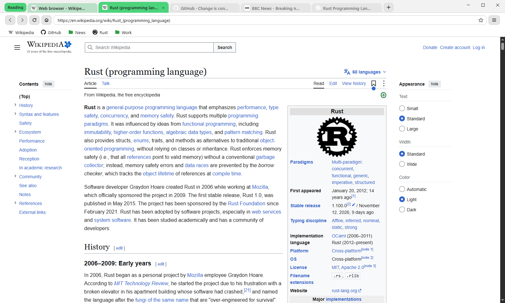

# Suppa Browser

**A tiny, fast, private web browser for Windows (and now Linux) - a single 3 MB `.exe` with a built-in ad blocker, Chrome extensions, tab groups and a fully customisable interface.**

Written in Rust on top of Microsoft **WebView2**, the Chromium engine that is already part of Windows 10/11 - so pages render exactly like in Chrome/Edge, while Suppa itself stays very small.


---

## Highlights

- **Tiny** - one `Suppa.exe` of about **3 MB**. No DLLs, no background services. Use the small optional setup or just run the exe.
- **Fast** - the window and its toolbar are ready in about **0.2 s**; the ad blocker is ready in **25 ms**.
- **Light on CPU and RAM** - background tabs fall asleep and unload automatically; about **0.1 % of one CPU core** when idle.
- **Private** - no account, no telemetry, no analytics. Suppa itself never sends anything about you anywhere (details below).
- **Ad and tracker blocker built in** - Brave's ad-block engine with EasyList, EasyPrivacy, uBlock filters and cookie-banner lists, plus your own rules.
- **Cookie popups handled for you** - "Accept all" is clicked automatically (can be turned off).
- **Chrome extensions** - install from the Chrome Web Store with **Add to Suppa**, with buttons and popups next to the address bar.
- **Tab groups** - drag a tab onto another and hold: they form a coloured, collapsible group.
- **Saved tabs bar** with folders and drag & drop, a ☆ to save a site in one click.
- **Your layout** - put tabs, address bar and saved tabs each where you like: top, bottom, or a column on the left/right (e.g. address bar on top, tabs and saved tabs on the left).
- **Your look** - darker / dark / light / lighter theme, a tint over the whole interface, any accent colour (or the Windows accent), every interface colour, round or squircle corners, which tab corners are rounded, five icon styles, interface scale.
- **Incognito tabs**, tab sorting, drag a tab out into a new window, crash recovery, backup & restore, bookmark import.
- **Hackable** - the whole interface is plain HTML/CSS/JS in a folder next to the exe; edit it and press **Update**.

---

## Screenshots

| | |
|---|---|
|  |  |
| **Dark theme** - tab group "Reading", saved tabs bar, extension-ready toolbar | **Light theme** |
|  |  |
| **The ≡ menu** - every menu follows the browser's theme | **Bar on the left** - vertical tabs, address and saved tabs in one column |
|  |  |
| **Saved tabs** - folders open as menus; drag to sort | **Settings** - look, layout, privacy, backup, update |


*Pro settings: change every colour of the interface (separately for the light and dark theme).*

---

## Speed and memory

Measured on Windows 10 (WebView2 157), Suppa 0.4, one web page open, 60 s after start:

| | |
|---|---|
| Program size | **3.0 MB** (`Suppa.exe`, everything included) |
| Window + toolbar ready | **~0.19 s** after start |
| Ad blocker ready | **25 ms** after start (cached filter engine, 1-2 ms on the UI thread) |
| CPU when idle | **63 ms of CPU per minute** for all Suppa processes together (≈ **0.1 %** of one core) |
| Memory of `Suppa.exe` itself | **13 MB** |
| Whole browser (all engine processes, 1 page) | **~270 MB** private memory, 8 processes |

How it stays light:

- **Sleeping tabs** - tabs you haven't looked at for 5 minutes are frozen (0 % CPU); after 30 minutes they are unloaded and free their memory. Clicking the tab loads it again. Tabs playing audio are never put to sleep. (Times can be changed in Settings.)
- **Lazy restore** - tabs from your last session only load when you click them.
- **Shared processes** - tabs of the same site share one renderer process; the toolbar and the menus share another.
- **Nothing runs in the background** - file changes are noticed through Windows change notifications instead of polling; a minimized window renders nothing.
- **Fast drawing** - pages are drawn by 4 raster threads and on the graphics card; big downloads use several connections.

Most of the memory is the Chromium engine itself (page renderer, GPU process, network). Suppa adds about 13 MB on top.

---

## Privacy

**Suppa does not collect any data.** There is no account, no telemetry, no analytics, no crash reporting and no "phone home" in Suppa's code. Everything stays on your PC in `%LOCALAPPDATA%\SuppaBrowser`.

The only connections Suppa itself makes:

| When | To | Why |
|---|---|---|
| First start, then every 4 days | easylist.to, ublockorigin.github.io, secure.fanboy.co.nz, raw.githubusercontent.com | download the ad-block filter lists |
| Only when you click **Add to Suppa** | clients2.google.com | download that extension from the Chrome Web Store |
| What you type in the address bar | the search engine you chose (Google, DuckDuckGo, Bing, Brave) | your search |

Extra privacy built in: ads and trackers are blocked, tracking `<a ping>` requests are switched off, Edge shopping/translate/SmartScreen extras are disabled, incognito tabs keep nothing after closing.

*Web pages are displayed by Microsoft's WebView2 runtime (part of Windows). Like any Windows component, it follows Windows' own diagnostic-data settings (Settings → Privacy → Diagnostics & feedback) - that is between Windows and Microsoft, not Suppa.*

---

## Features

### Tabs
- **New / close / reopen**: `Ctrl+T` (or `Ctrl+N`), `Ctrl+W` or middle-click, `Ctrl+Shift+T` reopens the last closed tab where it was.
- **Sort**: drag a tab left/right - the others slide aside. Smooth open/close animations; tabs only shrink when the row is full.
- **Tab groups**: drag a tab and **hold it over the middle of another tab** → they become a group (or the tab joins that tab's group). Each group has a coloured label: click it to collapse/expand, right-click to rename, change colour, ungroup or close the group. Grouped tabs are tinted with the group's colour. Right-click a tab → *Add to new group / Remove from group / Ungroup*. Groups are saved with the session.
- **New window**: drag a tab out of the window and let go - it opens in a new window (same logins and extensions).
- **Incognito**: `Ctrl+Shift+N` - a separate private profile; nothing is saved.
- **Crash recovery**: open tabs and groups are saved 2 seconds after every change and always come back after a crash.

### Saved tabs (bookmarks)
- ☆ at the end of the address bar saves the current site (★ = saved, click again to remove), or right-click a tab → *Save*.
- Drag to sort. Drop one item on the middle of another → a folder with both. Drop on a folder → moves inside. Drag a link out of an open folder onto the bar to take it out.
- Right-click for *Open in new tab / incognito, Rename, Delete, New folder*.

### Ad blocker and cookie popups
- Network blocking, cosmetic hiding and anti-ad scriptlets (Brave's `adblock-rust` engine).
- ≡ → *Ad blocker*: see how many requests were blocked, allow ads on a site, update lists.
- Your own rules: `scripts\filters\*.txt` (uBlock / AdBlock syntax).
- Cookie banners: "Accept all" is clicked automatically (many languages). Turn off in Settings.

### Extensions
- Open an extension on the Chrome Web Store and click **Add to Suppa** (Suppa downloads and installs it itself).
- Extension buttons appear right of the address bar: click = the extension's popup under the button, right-click = options / hide / remove.
- ≡ → *Extensions* lists them all (enable/disable, options, show in toolbar, remove) and can load an unpacked folder.

### Look and layout (Settings)
- **Theme**: darker (black), dark, light, lighter (white); **tint**: any colour over the whole interface, 0-60 % (e.g. dark with 20 % red). Accent colour: rainbow per tab, 8 presets, any colour, or **the Windows accent colour**; text on accent: auto / black / white.
- **Interface scale** 75–150 % (pages keep their own zoom), **corner roundness** 0–20 px, **corner style** round or **squircle** (smooth superellipse corners everywhere, menus included).
- **Tab corners**: choose which of the four corners of a tab are rounded (or Auto).
- **Icon style**: Line, Bold, Sharp, Filled or Duotone (toolbar, saved tabs, window buttons).
- **Pro settings → Colors**: every colour of the interface, per theme.
- **Layout**: each row (tabs, address bar, saved tabs) at the **top, bottom, left or right**, or all at once; rows on the left/right share a column with vertical tabs (drag its edge to resize). Rows at the same edge follow the chosen **order**. With no row at the top the window buttons float over the top-right corner of the page.
- Drag the thin line under a row to resize it; ≡ → *Lock bar sizes* prevents accidents.
- The window has no Windows title bar - the tab row *is* the title bar (drag to move, double-click to maximize).

### Passwords, backup and import
- Passwords and form data are saved and filled in (can be turned off). *Delete saved passwords* in Settings.
- **Backup**: one `.zip` with settings, bar sizes, saved tabs, open tabs, scripts, extensions, saved passwords, form data and website logins. **Restore** applies it on the next start. (Passwords are encrypted by Windows for your account, so they restore on the same Windows account.)
- **Import bookmarks** from Chrome, Edge, Brave, Vivaldi, Opera or Firefox (found automatically) or from an exported bookmarks `.html` file.

### Everything else
- Themed menus everywhere (≡, tabs, saved tabs, page right-click) and themed dialogs. Right-click a page → **Inspect element** opens the developer tools on that element.
- Make Suppa your **default browser** (Settings or the prompt on first start).
- Remembers window size and position, full screen (`F11`), print, DevTools, downloads, task manager.
- Your own user scripts: `scripts\userscripts\*.js` (with `// @match` patterns).

---

## Keyboard shortcuts

| Keys | Action |
|---|---|
| `Ctrl+T` / `Ctrl+N` | New tab |
| `Ctrl+Shift+N` | New incognito tab |
| `Ctrl+W`, `Ctrl+F4` | Close tab |
| `Ctrl+Shift+T` | Reopen closed tab |
| `Ctrl+Tab` / `Ctrl+Shift+Tab` | Next / previous tab |
| `Ctrl+1` … `Ctrl+9` | Go to tab 1…8 / last tab |
| `Ctrl+L`, `Alt+D`, `F6` | Address bar (`Ctrl+Enter` turns `name` into `www.name.com`) |
| `F5`, `Ctrl+R` / `Ctrl+F5`, `Ctrl+Shift+R` | Reload / reload without cache |
| `Alt+Left` / `Alt+Right` / `Alt+Home` | Back / forward / home |
| `Ctrl++` / `Ctrl+-` / `Ctrl+0` | Zoom in / out / reset |
| `Alt+S` | Settings |
| `F11` | Full screen |
| `Ctrl+J` / `Shift+Esc` | Downloads / task manager |
| `Ctrl+P`, `Ctrl+F`, `F12` | Print, find, developer tools |

---

## Install

**Requirements:** Windows 10 or 11 (64-bit) with the Microsoft Edge WebView2 Runtime (already included in up-to-date Windows 10/11).

**Setup (recommended):** download **`SuppaSetup.exe`** from the [Releases](../../releases) page and run it.
- Installs for your Windows account only, no administrator rights needed, in `%LOCALAPPDATA%\Programs\Suppa`.
- Adds Start-menu and desktop shortcuts and an entry in **Windows Settings → Apps**, where you can uninstall it.
- If the WebView2 Runtime is missing, it offers to download and install it from Microsoft.
- Run a newer `SuppaSetup.exe` to update: your tabs, settings, own filter rules and user scripts are kept.
- The setup window follows your Suppa theme, accent colour and corner roundness.
- Silent use: `SuppaSetup.exe /S` installs, `SuppaSetup.exe --uninstall /S` removes (your data is kept).

**Portable:** get the `.zip` from the [Releases](../../releases) page, unpack it anywhere and run `Suppa.exe`.

**Build it yourself:** double-click **`build.bat`**. It installs anything missing (Rust, the Microsoft C++ Build Tools, the WebView2 runtime), then builds `dist\Suppa.exe` (with the `scripts` folder next to it) and `dist\SuppaSetup.exe`.

### Linux

Suppa for Linux is the same browser on **GTK + WebKitGTK** (the engine of GNOME Web) instead of WebView2. It uses the same `scripts` folder, so the bar, menus, Settings, themes, layouts, saved tabs, tab groups, ad blocker, cookie-popup handling, incognito tabs, crash recovery and the Update button work the same way.

**Requirements:** a 64-bit Linux desktop with WebKitGTK 4.1 (preinstalled on most GNOME desktops; otherwise `sudo apt install libwebkit2gtk-4.1-0`, `sudo dnf install webkit2gtk4.1` or `sudo pacman -S webkit2gtk-4.1`).

**Download:** get `Suppa-<version>-linux-x64.tar.gz` from the [Releases](../../releases) page, unpack it and run:

```sh
sh install.sh
```

It installs for your user only (no root): the program in `~/.local/share/suppa-browser`, a `suppa` command in `~/.local/bin` and a menu entry with the icon. `sh install.sh --uninstall` removes it; your settings and tabs stay in `~/.local/share/SuppaBrowser`.

**Build it yourself:** `sh linux/build.sh` installs what is missing (Rust, the WebKitGTK development files), then builds `dist/linux/` with `suppa`, `scripts/` and `install.sh`.

Not in the Linux version (yet): Chrome extensions (WebKitGTK has no extension support), saved passwords and form filling, backup and bookmark import, the setup program, and freezing background tabs (they are unloaded after the set time instead). On Wayland desktops Suppa runs through XWayland so its menus can be placed exactly.

---

## Customise without recompiling

Everything in `scripts\` next to `Suppa.exe` can be edited:

| File | What it controls |
|---|---|
| `ui.html`, `ui.css`, `ui.js` | the toolbar: tabs, window buttons, address bar, saved tabs, colours |
| `menu.html` | all menus and dialogs |
| `settings.html` | the Settings tab |
| `cookies.js` | which cookie buttons are clicked |
| `webstore.js` | the Chrome Web Store "Add to Suppa" helper |
| `newtab.html` | the optional Suppa start page |
| `userscripts\*.js` | your own scripts for web pages |
| `filters\*.txt` | your own ad-block rules |

When a file changes, the **≡** button becomes **Update ≡** - click Update and Suppa restarts with your changes (tabs come back). If you change the Rust code in the project folder, Update rebuilds `Suppa.exe` first.

---

## Code layout

| File | What it does |
|---|---|
| `src/main.rs` | Entry point and module list |
| `src/app.rs` | Shared state, tabs, groups, command IDs |
| `src/window.rs` | Main window, message loop, commands, layout of the frame, update/restart, crash recovery |
| `src/ui.rs` | Hosts the HTML toolbar, bar/page layout (each row top/bottom/left/right), scale, theme colours and tint |
| `src/winbtn.rs` | Window buttons floating over the page when no row is at the top |
| `src/tabs.rs` / `src/groups.rs` | Tabs (open, close, sort, detach) / tab groups |
| `src/webview.rs` | WebView2 setup, page events, request interception, page context menus |
| `src/adblock.rs` | Filter lists, network blocking, cosmetic CSS, scriptlets |
| `src/extensions.rs` / `src/extpopup.rs` | Chrome extensions / extension popup window |
| `src/popup.rs` | Themed menus and dialogs |
| `src/saved.rs` | Saved tabs bar, folders, star button |
| `src/settings.rs` / `src/settings_page.rs` | settings.ini, session / the Settings tab |
| `src/backup.rs` / `src/import.rs` | Backup & restore / bookmark import |
| `src/sleeper.rs` | Sleeping and unloading background tabs |
| `src/scripts.rs` | The scripts folder, change detection, rebuild |
| `src/default_browser.rs`, `src/shortcuts.rs`, `src/menu.rs`, `src/util.rs` | Default browser, shortcuts, ≡ menu, helpers |
| `build.rs` | Embeds the manifest and draws the icon from `assets/icon.svg` |
| `installer/` | `SuppaSetup.exe`: install, update and uninstall, in a window drawn in Suppa's style |
| `linux/` | Suppa for Linux (GTK + WebKitGTK): same scripts, same settings code (`src/settings.rs`), its own window, tabs, menus and ad-block host code; `linux/build.sh`, `linux/install.sh` |

---

## Known limits

- The Linux version has fewer features than the Windows one (see [Linux](#linux)).
- Most Chrome extensions work; a few that need Chrome-only APIs may not load.
- Passwords can't be imported from Chrome/Edge (they lock them for themselves) - use Suppa's backup instead.

## License

[MIT](LICENSE)
