# Suppa Browser

<a href="https://www.buymeacoffee.com/Un1que0ff"></a>

[English](README.md) · **Русский** · [Deutsch](README.de.md) · [Español](README.es.md) · [中文](README.zh.md)

**Маленький, быстрый и приватный браузер для Windows (а теперь и Linux): один `.exe` размером 3 МБ со встроенным блокировщиком рекламы, расширениями Chrome, группами вкладок и полностью настраиваемым интерфейсом.**

Написан на Rust поверх Microsoft **WebView2** — движка Chromium, который уже входит в Windows 10/11. Поэтому страницы выглядят точно так же, как в Chrome/Edge, а сам Suppa остаётся очень маленьким.

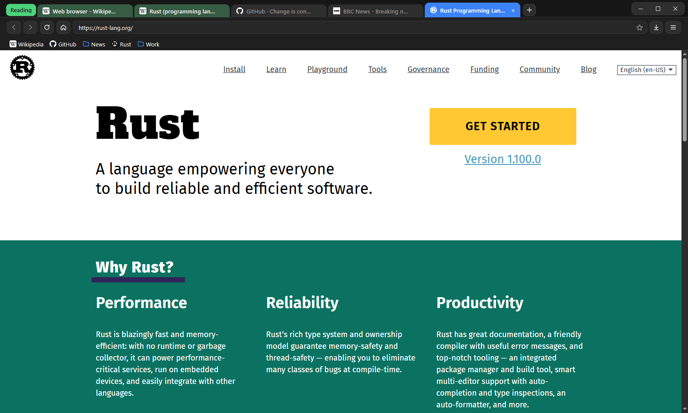

---

## Главное

- **Крошечный** — один `Suppa.exe` размером около **3 МБ**. Никаких DLL и фоновых служб. Можно поставить через небольшой установщик или просто запустить exe.
- **Быстрый** — окно и панель готовы примерно через **0,2 с**, блокировщик рекламы — через **25 мс**.
- **Бережёт процессор и память** — фоновые вкладки засыпают и выгружаются сами; в простое около **0,1 % одного ядра**.
- **Приватный** — без аккаунта, телеметрии и аналитики. Сам Suppa никуда ничего о вас не отправляет (подробности ниже).
- **Встроенный блокировщик рекламы и трекеров** — движок Brave со списками EasyList, EasyPrivacy, фильтрами и быстрыми исправлениями uBlock, списками для cookie-баннеров и вашими собственными правилами.
- **Реклама на YouTube пропускается** — прорвавшаяся реклама отключается по звуку, перематывается в конец, а кнопка **«Пропустить»** нажимается за вас (настоящим щелчком, который YouTube принимает); рекламные места в ленте и рядом с видео скрыты.
- **Окна cookie — без вашего участия** — по умолчанию **только необходимые cookie** («Отклонить все») или «Принять все», если хотите (Настройки → Конфиденциальность; можно отключить).
- **Адреса, карты и PayPal** — сохраняйте несколько адресов, платёжных карт и аккаунтов PayPal (в Настройках или из отправленной формы) и заполняйте их одним щелчком; для карт сначала нужен Windows Hello, коды безопасности не сохраняются.
- **Надёжные пароли** — в формах регистрации Suppa предлагает пароль вроде `A%$3G&8^ga12Kq`, вводит его и сохраняет для этого сайта.
- **Синхронизация и общий доступ через Dropbox** (по желанию) — пароли, адреса и карты в одном файле, зашифрованном вашей парольной фразой, через приложение Dropbox; их получает каждый ПК или человек с той же папкой и фразой.
- **Плеер и громкость каждой вкладки** — кнопка плеера рядом с загрузками показывает, что играет (обложка альбома из Spotify / Tidal, маленькое превью видео из YouTube), с паузой, следующим треком и ползунком громкости для каждой вкладки, независимо от громкости Windows. На вкладках есть значок динамика — щелчок выключает звук.
- **Сохранить видео / MP3** — щёлкните правой кнопкой по видео (или странице YouTube) и сохраните его или только звук в MP3.
- **Вкладка без сна** — выбранные вкладки никогда не засыпают в фоне.
- **Расширения Chrome** — установка из Chrome Web Store кнопкой **Add to Suppa**, с кнопками и всплывающими окнами рядом с адресной строкой.
- **Группы вкладок** — перетащите вкладку на другую и подержите: получится цветная сворачиваемая группа.
- **Панель сохранённых вкладок** с папками и перетаскиванием, ☆ сохраняет сайт одним щелчком.
- **Своё расположение** — вкладки, адресная строка и сохранённые вкладки где угодно: сверху, снизу или колонкой слева/справа (например, адрес сверху, вкладки и закладки слева).
- **Свой язык** — английский, русский, немецкий, испанский или китайский (по умолчанию язык Windows; Настройки → Внешний вид → Язык).
- **Свой вид** — темы «темнее» / тёмная / светлая / «светлее», оттенок на весь интерфейс, любой цвет акцента (или акцент Windows), любой цвет интерфейса, круглые углы или сквиркл, выбор скруглённых углов вкладок, пять стилей значков, масштаб интерфейса.
- **Вкладки инкогнито**, сортировка вкладок, вынос вкладки в новое окно, восстановление после сбоя, резервные копии, импорт закладок.
- **Менеджер паролей** — просмотр, поиск, копирование и удаление сохранённых паролей (сначала спрашивается Windows Hello или пароль Windows); импорт из Firefox, Chrome, Edge или Brave и экспорт в `.csv`.
- **История, загрузки и ярлыки** — страница истории с поиском, кнопка загрузок рядом с адресной строкой, заполняющаяся цветом акцента по мере загрузки, и самые посещаемые сайты с их значками на стартовой странице в вашей теме.
- **Значки сайтов под вашу тему** — во вкладках, сохранённых вкладках, истории и на стартовой странице; белые значки темнеют в светлой теме, чёрные светлеют в тёмной.
- **Обновляется сам** — раз в день проверяет GitHub; установленный через установщик, обновляется одним щелчком и показывает, что нового.
- **Легко переделать** — весь интерфейс — это обычные HTML/CSS/JS в папке рядом с exe; измените и нажмите **Update**.

---

## Скриншоты

| | |
|---|---|
|  | 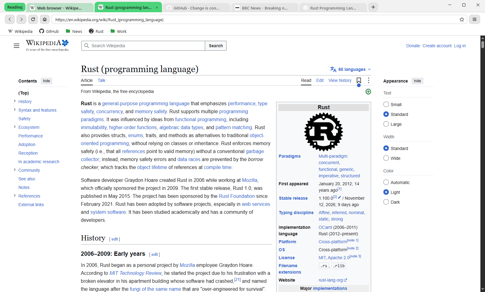 |
| **Тёмная тема** (синий акцент) — группа вкладок «Reading», панель сохранённых вкладок, кнопка загрузок у адресной строки | **Светлая тема** (индиго) — значки сайтов подстраиваются под тему |
| 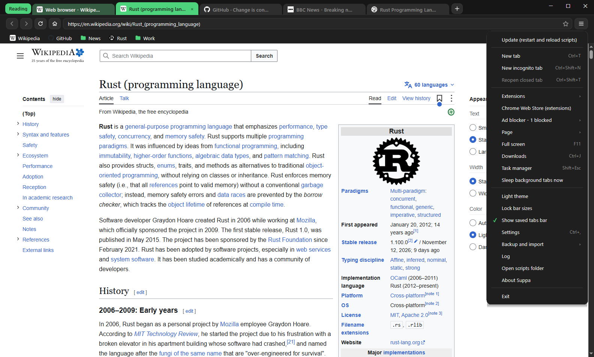 | 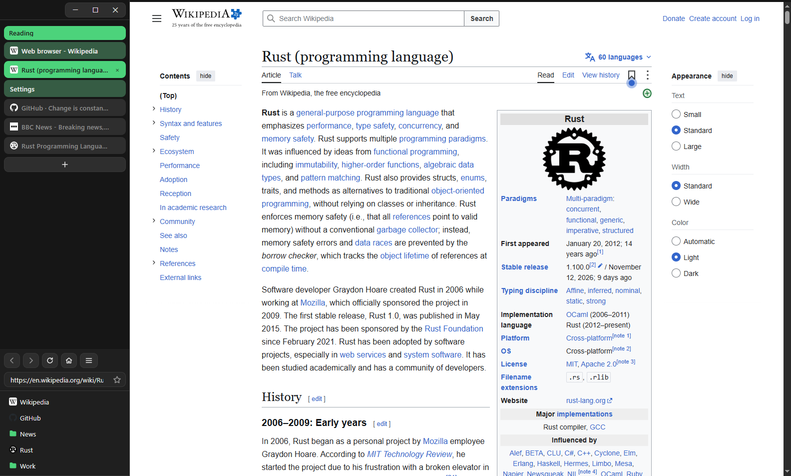 |
| **Меню ≡** (оранжевый акцент) — все меню следуют теме браузера | **Панель слева** (салатовый акцент) — вертикальные вкладки, адрес и сохранённые вкладки в одной колонке |
| 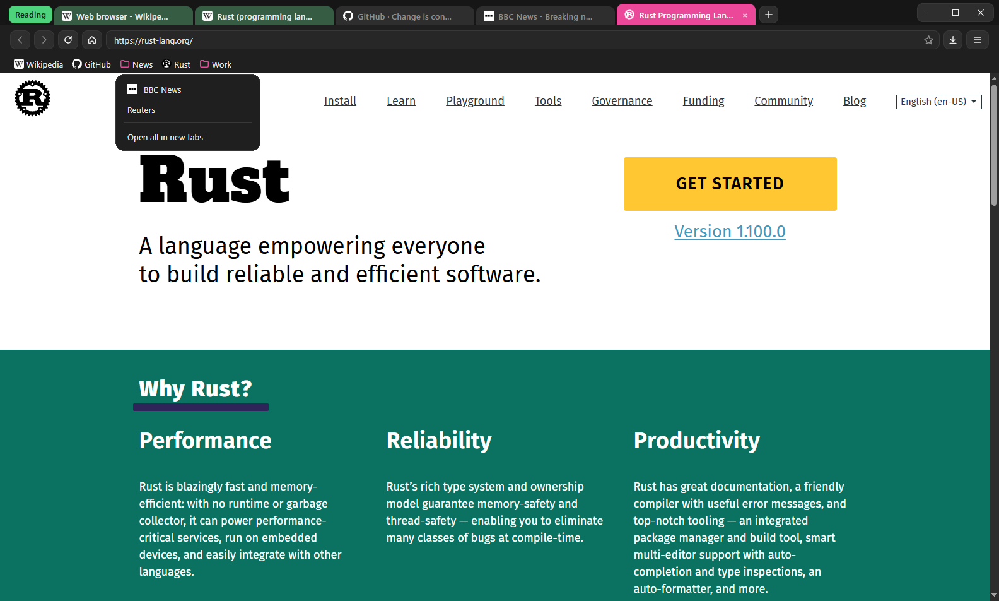 | 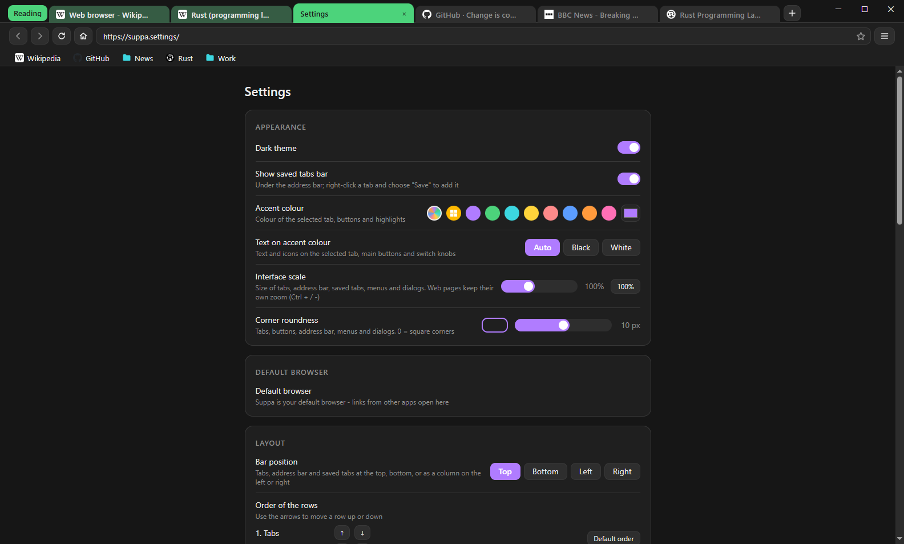 |
| **Сохранённые вкладки** (розовый акцент) — папки открываются как меню; перетаскивайте для сортировки | **Настройки** (жёлтый акцент) — разделы слева: вид, углы, расположение, конфиденциальность, пароли, резервная копия, обновления |
| 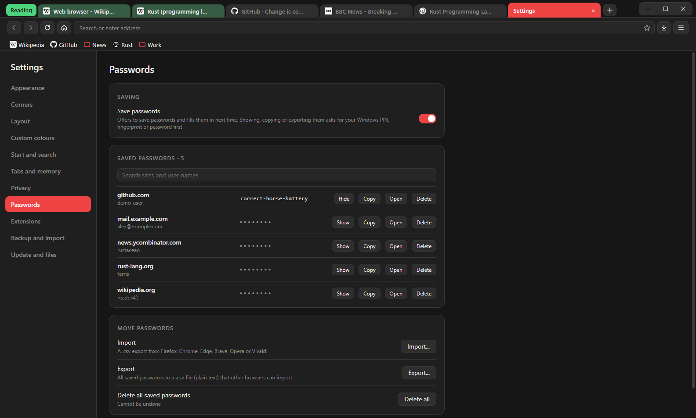 | 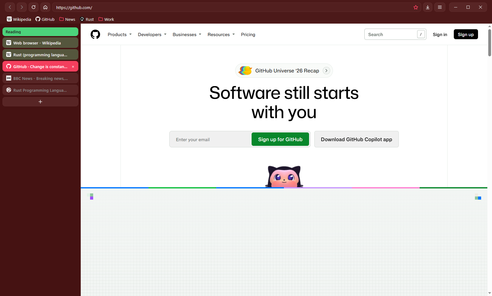 |
| **Менеджер паролей** (красный акцент, демо-записи) — поиск, показ, копирование, удаление; импорт из Firefox, Chrome, Edge или Brave и экспорт в `.csv` | **Своё расположение и вид** (розовый акцент) — вкладки слева, адрес сверху, тёмная тема с 20 % красного |
| 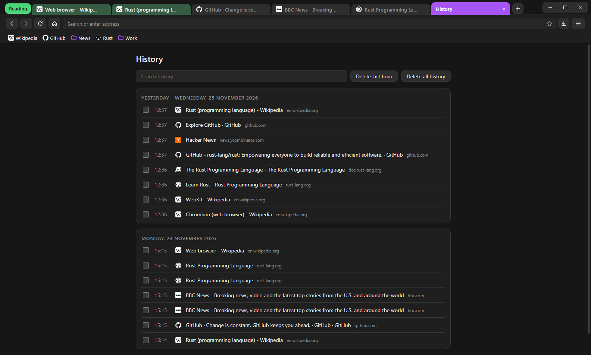 | 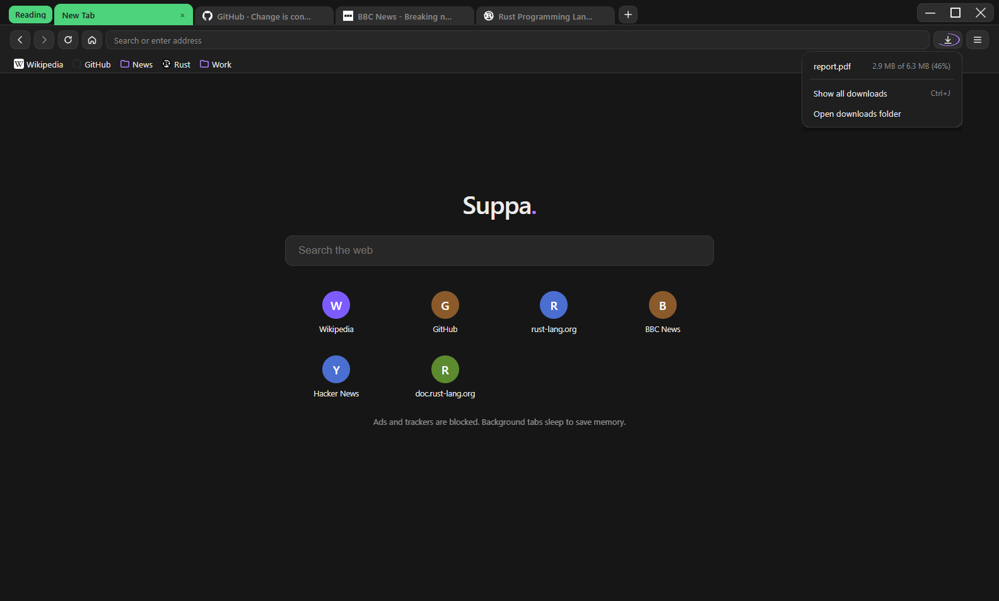 |
| **История** (`Ctrl+H`, фиолетовый акцент) — по дням, со значками сайтов и поиском | **Стартовая страница** (бирюзовый акцент) — самые посещаемые сайты со значками и загрузка, заполняющая кнопку загрузок |

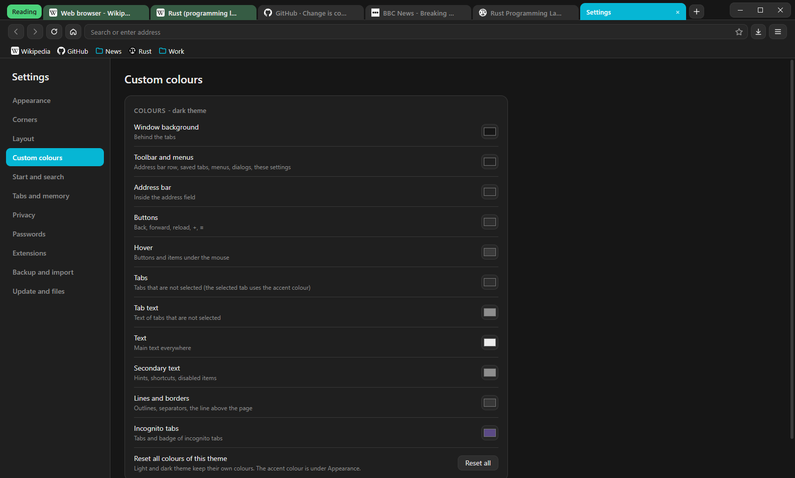
*Настройки → Свои цвета (голубой акцент): любой цвет интерфейса (отдельно для светлой и тёмной темы).*

---

## Скорость и память

Измерено на Windows 10 (WebView2 157), Suppa 0.4, одна открытая страница, через 60 с после запуска:

| | |
|---|---|
| Размер программы | **3,0 МБ** (`Suppa.exe`, всё включено) |
| Окно и панель готовы | **~0,19 с** после запуска |
| Блокировщик рекламы готов | **25 мс** после запуска (кэшированный движок фильтров, 1–2 мс в UI-потоке) |
| Процессор в простое | **63 мс процессорного времени в минуту** для всех процессов Suppa вместе (≈ **0,1 %** одного ядра) |
| Память самого `Suppa.exe` | **13 МБ** |
| Весь браузер (все процессы движка, 1 страница) | **~270 МБ** собственной памяти, 8 процессов |

Почему он лёгкий:

- **Спящие вкладки** — вкладки, которые вы не открывали 5 минут, замораживаются (0 % процессора); через 30 минут выгружаются и освобождают память. Щелчок по вкладке загружает её снова. Вкладки со звуком и вкладки «без сна» не засыпают. (Время меняется в Настройках.)
- **Ленивое восстановление** — вкладки прошлого сеанса загружаются только при щелчке.
- **Общие процессы** — вкладки одного сайта делят один процесс отрисовки; панель и меню — другой.
- **Ничего в фоне** — изменения файлов отслеживаются через уведомления Windows, а не опросом; свёрнутое окно ничего не рисует.
- **Быстрая отрисовка** — страницы рисуют 4 потока растеризации на видеокарте; большие загрузки идут в несколько соединений.

Большая часть памяти — это сам движок Chromium (отрисовка страниц, GPU-процесс, сеть). Suppa добавляет сверху около 13 МБ.

---

## Конфиденциальность

**Suppa не собирает никаких данных.** В коде Suppa нет аккаунта, телеметрии, аналитики, отчётов о сбоях и «звонков домой». Всё хранится на вашем ПК в `%LOCALAPPDATA%\SuppaBrowser`.

Единственные соединения, которые делает сам Suppa:

| Когда | Куда | Зачем |
|---|---|---|
| При первом запуске, затем раз в 4 дня | easylist.to, ublockorigin.github.io, secure.fanboy.co.nz, raw.githubusercontent.com | загрузить списки фильтров рекламы |
| Только когда вы нажимаете **Add to Suppa** | clients2.google.com | скачать это расширение из Chrome Web Store |
| Раз в день (отключается в Настройки → Обновления и файлы) и когда вы нажимаете **Проверить обновления** | api.github.com, github.com | узнать номер новейшей версии и её описание; скачать обновление, когда вы нажмёте **Обновить** |
| То, что вы вводите в адресной строке | выбранный поисковик (Google, DuckDuckGo, Bing, Brave) | ваш поиск |
| Только при первом использовании **Сохранить видео / MP3** (сначала спрашивается), затем проверка обновления yt-dlp не чаще раза в неделю при сохранении | github.com | скачать yt-dlp и FFmpeg в папку данных Suppa (`tools\`) |

**Синхронизация с Dropbox** (выключена, пока вы её не включите) сама не устанавливает соединений: Suppa пишет один файл в папку Dropbox, а приложение Dropbox его синхронизирует. Файл зашифрован вашей парольной фразой (PBKDF2-SHA256 + AES-256-GCM), поэтому Dropbox не может его прочитать.

Дополнительная защита: реклама и трекеры блокируются, отслеживающие запросы `<a ping>` отключены, лишнее от Edge (покупки, переводчик, SmartScreen) выключено, вкладки инкогнито ничего не хранят после закрытия.

*Веб-страницы показывает среда Microsoft WebView2 (часть Windows). Как любой компонент Windows, она следует настройкам диагностических данных самой Windows (Параметры → Конфиденциальность → Диагностика и отзывы) — это между Windows и Microsoft, а не Suppa.*

---

## Возможности

### Вкладки
- **Создать / закрыть / вернуть**: `Ctrl+T` (или `Ctrl+N`), `Ctrl+W` или средняя кнопка мыши, `Ctrl+Shift+T` возвращает последнюю закрытую вкладку на её место.
- **Сортировка**: тащите вкладку влево/вправо — остальные расступаются. Плавные анимации; вкладки сужаются, только когда строка заполнена.
- **Группы вкладок**: перетащите вкладку и **подержите над серединой другой** → они станут группой (или вкладка войдёт в группу той вкладки). У каждой группы цветная метка: щелчок сворачивает/разворачивает, правая кнопка — переименовать, сменить цвет, разгруппировать или закрыть группу. Вкладки группы окрашены её цветом. Правая кнопка по вкладке → *Добавить в новую группу / Убрать из группы / Разгруппировать*. Группы сохраняются вместе с сеансом.
- **Новое окно**: вытащите вкладку за пределы окна и отпустите — она откроется в новом окне (те же входы на сайты и расширения).
- **Инкогнито**: `Ctrl+Shift+N` — отдельный приватный профиль; ничего не сохраняется.
- **Восстановление после сбоя**: открытые вкладки и группы сохраняются через 2 секунды после каждого изменения и всегда возвращаются после сбоя.

### Сохранённые вкладки (закладки)
- ☆ в конце адресной строки сохраняет текущий сайт (★ = сохранён, повторный щелчок убирает), или правая кнопка по вкладке → *Сохранить*.
- Перетаскивайте для сортировки. Бросьте один элемент на середину другого → папка с обоими. Бросьте на папку → переместится внутрь. Вытащите ссылку из открытой папки на панель, чтобы достать её.
- Правая кнопка: *Открыть в новой вкладке / инкогнито, Переименовать, Удалить, Новая папка*.

### Блокировщик рекламы и окна cookie
- Сетевая блокировка, косметическое скрытие и анти-рекламные скриптлеты (движок Brave `adblock-rust`).
- ≡ → *Блокировщик рекламы*: сколько запросов заблокировано, разрешить рекламу на сайте, обновить списки.
- Свои правила: `scripts\filters\*.txt` (синтаксис uBlock / AdBlock).
- На cookie-баннеры отвечается автоматически (на многих языках): по умолчанию **только необходимые** cookie («Отклонить все» / «Только необходимые» или × баннера, если такой кнопки нет), либо **принять все** — Настройки → Конфиденциальность. Там же можно отключить.
- YouTube: видеореклама отключается по звуку, перематывается в конец, а кнопка **«Пропустить»** нажимается настоящим (доверенным) щелчком мыши, так что нажимать её не придётся.

### Адреса, платежи и пароли
- **Настройки → Адреса и платежи**: добавляйте сколько угодно адресов (Дом, Работа, ...), платёжных карт и аккаунтов PayPal или позвольте Suppa предложить их сохранить при отправке формы. Всё зашифровано для вашей учётной записи Windows (`vault.dat`).
- В веб-формах в полях адреса, карты, PayPal и пароля появляется маленькая **кнопка-ключ**. Она открывает меню самого Suppa — страница никогда не видит сохранённое — и подставляет только то, что вы выберете. Карты подставляются после Windows Hello; код безопасности (CVC) не сохраняется. Если магазин принимает и PayPal, в меню есть **Оплатить через PayPal**; на странице входа PayPal подставляется ваш e-mail PayPal.
- **Надёжные пароли**: в форме регистрации кнопка-ключ предлагает созданный пароль (заглавные и строчные буквы, цифры, символы). Suppa вводит его в оба поля пароля, сохраняет для сайта и при следующем запуске добавляет в собственное хранилище паролей браузера. В Настройки → Пароли тоже есть генератор (`Ctrl+Shift+G` копирует пароль).
- **Синхронизация и общий доступ через Dropbox** (Настройки → Пароли, по умолчанию выключено): один файл в `Dropbox\Apps\Suppa`, зашифрованный вашей парольной фразой. Каждый ПК с той же фразой — и каждый, с кем вы делитесь этой папкой Dropbox, — получает те же пароли, адреса и карты; изменения объединяются по записям, удаления передаются. Вместо Dropbox можно выбрать любую другую синхронизируемую папку (OneDrive, флешку).

### Медиа
- **Кнопка плеера** рядом с кнопкой загрузок (≡ → Вид и панель → Показывать кнопку плеера), пока вкладка что-то играет: обложка альбома (Spotify, Tidal, SoundCloud, YouTube Music...) или маленькое живое превью видео (YouTube и большинство видеосайтов), пауза, предыдущий / следующий трек, отключение звука и **ползунок громкости только этой вкладки** — громкость Windows не меняется. Щелчок по названию переключает на вкладку. `Ctrl+Shift+M` открывает плеер.
- На играющих вкладках виден **динамик** (щелчок = выключить звук, `Ctrl+M`); правая кнопка по вкладке → **Звук**: выключить звук и громкость 100 / 75 / 50 / 25 / 10 %.
- **Сохранить видео / MP3**: правая кнопка по видео или аудио (или в любом месте страницы YouTube, Vimeo, SoundCloud...), всплывающий плеер или ≡ → Эта страница. Обычные видеофайлы скачиваются напрямую; для стриминговых сайтов и MP3 используются бесплатные программы yt-dlp и FFmpeg, которые Suppa один раз скачивает после вопроса. Файлы попадают в папку «Загрузки». (Сохраняйте только то, что вам разрешено.)
- **Без сна**: правая кнопка по вкладке → *Не усыплять* (или ≡ → Эта страница): вкладка никогда не замораживается и не выгружается в фоне (на ней видно маленькое солнце).

### Расширения
- Откройте расширение в Chrome Web Store и нажмите **Add to Suppa** (Suppa сам скачает и установит его).
- Кнопки расширений появляются справа от адресной строки: щелчок = всплывающее окно расширения, правая кнопка = параметры / скрыть / удалить.
- ≡ → *Расширения* показывает их все (включить/выключить, параметры, показ на панели, удаление) и может загрузить распакованную папку.

### Вид и расположение (Настройки)
- **Язык**: English, Русский, Deutsch, Español или 中文 — меню, Настройки, панель и страницы Suppa. *Автоматически* (по умолчанию) — язык интерфейса Windows или английский, если такого языка в Suppa нет. Переводы лежат в `scripts\lang.json`.
- **Тема**: **Системная** (светлая или тёмная, как в Windows, — по умолчанию), «темнее» (чёрная), тёмная, светлая, «светлее» (белая); **оттенок**: любой цвет поверх всего интерфейса, 0–60 % (например, тёмная с 20 % красного). Цвет акцента: радуга по вкладкам, 8 готовых, любой цвет или **цвет акцента Windows** (по умолчанию); текст на акценте: авто / чёрный / белый.
- **Масштаб интерфейса** 75–150 % (страницы сохраняют свой масштаб), **скругление углов** 0–20 px, **стиль углов** круглый или **сквиркл** (плавные углы-суперэллипсы везде, включая меню).
- **Углы вкладок**: какие из четырёх углов вкладки скруглять (или Авто).
- **Стиль значков**: Линии, Жирные, Острые, Заливка или Двухцветные (панель, сохранённые вкладки, кнопки окна).
- **Настройки → Свои цвета**: любой цвет интерфейса, для каждой темы.
- **Расположение**: каждая строка (вкладки, адресная строка, сохранённые вкладки) **сверху, снизу, слева или справа**, или все сразу; строки слева/справа делят колонку с вертикальными вкладками (тяните её край, чтобы изменить ширину). Строки у одного края идут в выбранном **порядке**. Если сверху нет строк, кнопки окна парят над правым верхним углом страницы.
- Тяните тонкую линию под строкой, чтобы изменить её высоту; ≡ → *Закрепить размеры панелей* защищает от случайностей.
- У окна нет заголовка Windows — строка вкладок *и есть* заголовок (тяните, чтобы двигать, двойной щелчок разворачивает).

### Пароли, резервные копии и импорт
- Пароли и данные форм сохраняются и подставляются (можно отключить).
- **Менеджер паролей**: Настройки → Пароли показывает все сохранённые пароли с поиском, кнопками Показать, Копировать, Открыть и Удалить (удаление вступает в силу при перезапуске Suppa — движок держит хранилище заблокированным, пока работает). **Экспорт** записывает их все в `.csv`, который могут импортировать другие браузеры. Показать, Копировать и Экспорт сначала спрашивают Windows, вы ли это (**Windows Hello** — PIN, отпечаток или лицо — или пароль Windows); одна проверка действует минуту.
- **Резервная копия**: один `.zip` с настройками, размерами панелей, сохранёнными и открытыми вкладками, скриптами, расширениями, сохранёнными паролями, данными форм и входами на сайты. **Восстановление** применяется при следующем запуске. (Пароли зашифрованы Windows для вашей учётной записи, поэтому восстанавливаются в той же учётной записи Windows.)
- **Импорт закладок** из Chrome, Edge, Brave, Vivaldi, Opera или Firefox (находятся автоматически) или из экспортированного файла закладок `.html`.
- **Импорт паролей** из экспорта паролей Firefox, Chrome, Edge или Brave (`.csv`): Настройки → Пароли → Импорт или ≡ → Резервная копия и импорт → Импорт паролей из файла. В Brave: brave://password-manager/settings → Export passwords. В Firefox: about:logins → ⋯ → Экспорт логинов. Пароли сразу шифруются для вашей учётной записи Windows и попадают в хранилище Suppa при перезапуске; затем Suppa предлагает удалить файл экспорта (в нём пароли открытым текстом).

### История и загрузки
- **История** (`Ctrl+H`, ≡ → История): каждая страница, открытая в обычной вкладке, по дням, с поиском; удаление отдельных страниц, последнего часа или всего. При первом запуске копируется история, которая уже была у движка. Вкладки инкогнито никогда не записываются.
- **Ярлыки стартовой страницы**: стартовая страница Suppa показывает 8 самых посещаемых сайтов за 90 дней со значками их вкладок (цветная буква, если значка нет); × убирает ярлык. Стартовая страница использует вашу тему и цвет акцента и показывает версию Suppa. Сохранённые вкладки и история показывают те же значки, так что импортированные закладки получают свои, как только вы посетите сайт.
- **Загрузки**: никакого окна загрузок Edge. Когда загрузка начинается, открывается окошко с прогрессом, а кнопка загрузок у адресной строки заполняется цветом акцента по часовой стрелке (кнопку можно скрыть: ≡ → Показывать кнопку загрузок). Щелчок = открыть / пауза / продолжить, правая кнопка = Показать в папке, Отменить, Скачать снова, Убрать. **Страница загрузок** (`Ctrl+J`) показывает все загрузки с поиском, Открыть, Показать в папке, Пауза / Продолжить и Отменить.

### Обновления
- Раз в день Suppa спрашивает у GitHub новейшую версию (только номер версии; отключается в Настройки → Обновления и файлы). ≡ → **Проверить обновления** спрашивает сразу.
- Если установлен через установщик: **Обновить** скачивает новый `SuppaSetup.exe` и тихо запускает его; Suppa закрывается, обновляется и открывается снова с вашими вкладками. Переносная копия вместо этого открывает страницу загрузки.
- После обновления **Что нового** показывает описание версии с GitHub (также в Настройки → Обновления и файлы).

### Всё остальное
- Меню в теме браузера везде (≡, вкладки, сохранённые вкладки, правая кнопка на странице) и такие же диалоги. Правая кнопка на странице → **Просмотреть код** открывает инструменты разработчика на этом элементе.
- Сделайте Suppa **браузером по умолчанию** (Настройки или вопрос при первом запуске).
- Запоминает размер и положение окна, полный экран (`F11`), печать, инструменты разработчика, диспетчер задач.
- Свои пользовательские скрипты: `scripts\userscripts\*.js` (с шаблонами `// @match`).

---

## Сочетания клавиш

Те же клавиши, что в Chrome, Edge и Firefox. `F1` (≡ → Справка и обновления → Сочетания клавиш) показывает их все прямо в Suppa.

| Клавиши | Действие |
|---|---|
| `Ctrl+T` / `Ctrl+N` | Новая вкладка |
| `Ctrl+Shift+N` | Новая вкладка инкогнито |
| `Ctrl+W`, `Ctrl+F4` / `Ctrl+Shift+W` | Закрыть вкладку / закрыть окно |
| `Ctrl+Shift+T` | Вернуть закрытую вкладку |
| `Ctrl+Tab`, `Ctrl+PgDn` / `Ctrl+Shift+Tab`, `Ctrl+PgUp` | Следующая / предыдущая вкладка |
| `Ctrl+Shift+PgUp` / `Ctrl+Shift+PgDn` | Сдвинуть вкладку влево / вправо |
| `Ctrl+1` … `Ctrl+9` | Вкладка 1…8 / последняя вкладка |
| `Ctrl+M` | Выключить / включить звук вкладки |
| `Ctrl+L`, `Alt+D`, `F6`, `Ctrl+E`, `Ctrl+K` | Адресная строка (`Ctrl+Enter` превращает `name` в `www.name.com`) |
| `F5`, `Ctrl+R` / `Ctrl+F5`, `Ctrl+Shift+R` | Обновить / обновить без кэша |
| `Alt+Left` / `Alt+Right` / `Alt+Home` | Назад / вперёд / домой |
| `Ctrl+D` / `Ctrl+Shift+B` | Сохранить страницу на панель сохранённых вкладок / показать или скрыть панель |
| `Ctrl++` / `Ctrl+-` / `Ctrl+0` | Увеличить / уменьшить / сбросить масштаб |
| `Alt+S`, `Ctrl+,` | Настройки |
| `Alt+F`, `Alt+E`, `F10` | Открыть меню ≡ |
| `F11` | Полный экран |
| `Ctrl+H` / `Ctrl+J` / `Shift+Esc` | История / загрузки / диспетчер задач |
| `Ctrl+Shift+M` / `Ctrl+Shift+G` | Плеер / копировать новый надёжный пароль |
| `Ctrl+O` / `Ctrl+U` | Открыть файл / исходный код страницы |
| `Ctrl+Shift+Delete` | Очистить данные браузера |
| `Ctrl+P`, `Ctrl+F`, `F12`, `Ctrl+Shift+I` | Печать, поиск, инструменты разработчика |
| `F1` | Список сочетаний |

`Ctrl+D`, `Ctrl+E`, `Ctrl+K`, `Ctrl+M` и `Ctrl+U` сначала получает страница, как в Chrome: редактор, который сам их использует (ссылка по `Ctrl+K`, подчёркивание по `Ctrl+U`), их сохраняет.

---

## Установка

**Требования:** Windows 10 или 11 (64-бит) с Microsoft Edge WebView2 Runtime (уже есть в обновлённой Windows 10/11).

**Установщик (рекомендуется):** скачайте **`SuppaSetup.exe`** на странице [Releases](../../releases) и запустите.
- Ставит только для вашей учётной записи Windows, без прав администратора, в `%LOCALAPPDATA%\Programs\Suppa`.
- Добавляет ярлыки в меню «Пуск» и на рабочий стол и запись в **Параметры Windows → Приложения**, где его можно удалить.
- Если WebView2 Runtime нет, предлагает скачать и установить его с сайта Microsoft.
- Suppa обновляется сам (Настройки → Обновления и файлы), или запустите новый `SuppaSetup.exe`: вкладки, настройки, свои правила фильтров и пользовательские скрипты сохраняются.
- Окно установщика следует вашей теме Suppa, цвету акцента и скруглению углов.
- Тихий режим: `SuppaSetup.exe /S` устанавливает, `SuppaSetup.exe --uninstall /S` удаляет (ваши данные остаются).

**Переносная версия:** возьмите `.zip` на странице [Releases](../../releases), распакуйте куда угодно и запустите `Suppa.exe`.

**Собрать самостоятельно:** дважды щёлкните **`build.bat`**. Он установит всё недостающее (Rust, Microsoft C++ Build Tools, среду WebView2), затем соберёт `dist\Suppa.exe` (с папкой `scripts` рядом) и `dist\SuppaSetup.exe`.

**Подпись кода (по желанию):** с сертификатом подписи кода `build.bat` подписывает `Suppa.exe` и `SuppaSetup.exe`, чтобы им доверял Windows SmartScreen. Перед запуском задайте в окружении одно из (никогда не в файле проекта): `SUPPA_SIGN_THUMBPRINT` (сертификат в хранилище сертификатов Windows), `SUPPA_SIGN_PFX` + `SUPPA_SIGN_PASSWORD` (файл `.pfx`) или `SUPPA_SIGN_ARGS` (свои аргументы `signtool`, например для Azure Trusted Signing). Нужен `signtool.exe` из Windows SDK. Без них сборка не подписывается, как и раньше.

### Linux

Suppa для Linux — тот же браузер на **GTK + WebKitGTK** (движок GNOME Web) вместо WebView2. Он использует ту же папку `scripts`, поэтому панель, меню, Настройки, темы, расположение, сохранённые вкладки, группы вкладок, блокировщик рекламы, обработка окон cookie, вкладки инкогнито, восстановление после сбоя и кнопка Update работают так же.

**Требования:** 64-битный Linux с WebKitGTK 4.1 (есть в большинстве окружений GNOME; иначе `sudo apt install libwebkit2gtk-4.1-0`, `sudo dnf install webkit2gtk4.1` или `sudo pacman -S webkit2gtk-4.1`).

**Скачать:** возьмите `Suppa-<version>-linux-x64.tar.gz` на странице [Releases](../../releases), распакуйте и запустите:

```sh
sh install.sh
```

Устанавливается только для вашего пользователя (без root): программа в `~/.local/share/suppa-browser`, команда `suppa` в `~/.local/bin` и пункт меню со значком. `sh install.sh --uninstall` удаляет её; настройки и вкладки остаются в `~/.local/share/SuppaBrowser`.

**Собрать самостоятельно:** `sh linux/build.sh` установит недостающее (Rust, файлы разработки WebKitGTK), затем соберёт `dist/linux/` с `suppa`, `scripts/` и `install.sh`.

Чего (пока) нет в версии для Linux: расширений Chrome (WebKitGTK их не поддерживает), сохранения паролей и заполнения форм, страниц истории и загрузок, обновлений, резервных копий и импорта закладок, установщика, заморозки фоновых вкладок (вместо этого они выгружаются через заданное время), а также новых функций 0.12 (адреса и платежи, плеер, сохранение видео). В окружениях Wayland Suppa работает через XWayland, чтобы меню вставали точно на место.

---

## Настройка без перекомпиляции

Всё в папке `scripts\` рядом с `Suppa.exe` можно править:

| Файл | За что отвечает |
|---|---|
| `ui.html`, `ui.css`, `ui.js` | панель: вкладки, кнопки окна, адресная строка, сохранённые вкладки, цвета |
| `menu.html` | все меню, диалоги и всплывающий плеер |
| `settings.html` | вкладка Настроек (разделы слева) |
| `lang.json`, `i18n.js` | переводы интерфейса (русский, немецкий, испанский, китайский) |
| `cookies.js` | какие кнопки cookie нажимаются |
| `youtube.js` | пропуск рекламы на YouTube (работает на youtube.com, пока там включён блокировщик) |
| `forms.js` | кнопка-ключ в формах: адреса, карты, PayPal, пароли |
| `media.js` | данные для плеера и громкость каждой вкладки |
| `webstore.js` | помощник «Add to Suppa» в Chrome Web Store |
| `newtab.html` | необязательная стартовая страница Suppa (поиск и самые посещаемые сайты) |
| `history.html`, `downloads.html` | страницы истории и загрузок |
| `userscripts\*.js` | ваши собственные скрипты для веб-страниц |
| `filters\*.txt` | ваши собственные правила блокировки рекламы |

Когда файл меняется, кнопка **≡** превращается в **Update ≡** — нажмите Update, и Suppa перезапустится с вашими изменениями (вкладки вернутся). Если вы изменили код Rust в папке проекта, Update сначала пересоберёт `Suppa.exe`.

---

## Устройство кода

| Файл | Что делает |
|---|---|
| `src/main.rs` | Точка входа и список модулей |
| `src/app.rs` | Общее состояние, вкладки, группы, ID команд |
| `src/window.rs` | Главное окно, цикл сообщений, команды, рамка, обновление/перезапуск, восстановление после сбоя |
| `src/ui.rs` | HTML-панель, расположение панели и страницы (каждая строка сверху/снизу/слева/справа), масштаб, цвета темы и оттенок, значок окна |
| `src/winbtn.rs` | Кнопки окна поверх страницы, когда сверху нет строк |
| `src/tabs.rs` / `src/groups.rs` | Вкладки (открыть, закрыть, сортировать, вынести) / группы вкладок |
| `src/webview.rs` | Настройка WebView2, события страниц, перехват запросов, контекстные меню страниц |
| `src/adblock.rs` | Списки фильтров, сетевая блокировка, косметический CSS, скриптлеты |
| `src/extensions.rs` / `src/extpopup.rs` | Расширения Chrome / окно расширения |
| `src/popup.rs` | Меню и диалоги в теме браузера |
| `src/saved.rs` | Панель сохранённых вкладок, папки, звёздочка |
| `src/settings.rs` / `src/settings_page.rs` | settings.ini, сеанс / вкладка Настроек |
| `src/backup.rs` / `src/import.rs` | Резервные копии / импорт закладок |
| `src/passwords.rs` / `src/auth.rs` | Менеджер паролей: список, показ, копирование, удаление, импорт и экспорт (`.csv`) через зашифрованное хранилище движка / проверка Windows Hello или пароля |
| `src/history.rs` / `src/downloads.rs` / `src/pages.rs` | История и ярлыки стартовой страницы / список и окно загрузок / страницы истории и загрузок |
| `src/updater.rs` | Обновления из релизов GitHub, «Что нового» |
| `src/sqlite.rs` | Встроенный в Windows SQLite для файлов паролей и истории движка |
| `src/sleeper.rs` | Усыпление и выгрузка фоновых вкладок (кроме вкладок «без сна») |
| `src/vault.rs` / `src/sync.rs` | Адреса, карты, PayPal, созданные пароли и заполнение форм (`scripts/forms.js`) / синхронизация и общий доступ через Dropbox |
| `src/i18n.rs` | Язык интерфейса для меню и диалогов (`scripts/i18n.js` переводит страницы; оба используют `scripts/lang.json`) |
| `src/media.rs` / `src/savemedia.rs` | Кнопка и окно плеера, громкость каждой вкладки (`scripts/media.js`) / сохранение видео и MP3 |
| `src/scripts.rs` | Папка scripts, отслеживание изменений, пересборка |
| `src/default_browser.rs`, `src/shortcuts.rs`, `src/menu.rs`, `src/util.rs` | Браузер по умолчанию, сочетания клавиш, меню ≡, вспомогательные функции |
| `build.rs` | Встраивает манифест и рисует значок из `assets/icon.svg`: белый на прозрачном фоне для тёмной темы Windows, чёрный — для светлой (Suppa переключает его вместе с Windows) |
| `installer/` | `SuppaSetup.exe`: установка, обновление и удаление в окне в стиле Suppa |
| `linux/` | Suppa для Linux (GTK + WebKitGTK): те же скрипты и код настроек (`src/settings.rs`), своё окно, вкладки, меню и блокировщик; `linux/build.sh`, `linux/install.sh` |
| `.github/workflows/release.yml` | Собирает `SuppaSetup.exe`, zip и tar.gz на GitHub и публикует релиз |

---

## Известные ограничения

- В версии для Linux меньше возможностей, чем в версии для Windows (см. [Linux](#linux)).
- Большинство расширений Chrome работает; некоторые, которым нужны API только Chrome, могут не загрузиться.
- Пароли импортируются из экспорта `.csv` другого браузера, а не читаются из его файлов напрямую (Chrome и Edge блокируют их для себя).

## Лицензия

[MIT](LICENSE)
