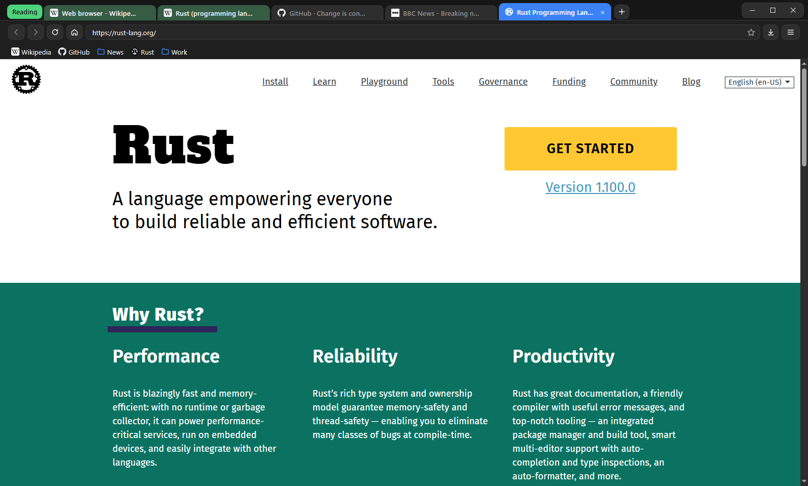

# Suppa Browser

[English](README.md) · [Русский](README.ru.md) · [Deutsch](README.de.md) · [Español](README.es.md) · **中文**

**一款小巧、快速、注重隐私的 Windows（及 Linux）浏览器：单个约 3 MB 的 `.exe`，内置广告拦截、Chrome 扩展、标签页分组和可完全自定义的界面。**

使用 Rust 基于 Microsoft **WebView2**（Windows 10/11 自带的 Chromium 引擎）编写——网页显示效果与 Chrome/Edge 完全一致，而 Suppa 本身非常小巧。

## 功能

- **小巧快速**——窗口约 0.2 秒即可就绪；后台标签页会休眠和卸载以节省 CPU 和内存（可让选定的标签页保持唤醒）。
- **注重隐私**——无需账户，没有遥测和分析。
- **广告和跟踪器拦截**（Brave 引擎），并**跳过 YouTube 广告**——Suppa 会替你点击“跳过”。
- **Cookie 弹窗**——默认只接受必要的 Cookie（“全部拒绝”），也可改为“全部接受”。
- **地址、银行卡和 PayPal**——可保存多个地址和银行卡并一键填写；填写银行卡前需通过 Windows Hello，安全码（CVC）从不保存。
- **强密码**——注册表单会获得一个类似 `A%$3G&8^ga12Kq` 的密码，由 Suppa 填写并保存。
- **通过 Dropbox 同步和共享**（可选）——密码、地址和银行卡保存在一个用你的口令加密的文件中。
- **播放器和每个标签页的音量**——Spotify / Tidal 封面、YouTube 视频预览、暂停、下一首，以及独立于 Windows 音量的每个标签页音量。
- **保存视频 / MP3**——右键单击视频或 YouTube 页面即可。
- **Chrome 扩展**、标签页分组、已保存标签页、历史记录、下载、密码管理器、备份。
- **你的外观**——默认跟随 Windows 主题和强调色，可设置色调、自定义颜色，工具栏可放在顶部、底部或两侧。
- **语言**——English、Русский、Deutsch、Español、中文（默认使用 Windows 语言；设置 → 外观 → 语言）。
- **键盘快捷键**与 Chrome、Edge 和 Firefox 相同——按 F1 查看列表。

## 安装

**系统要求：** Windows 10 或 11（64 位），并安装 Microsoft Edge WebView2 Runtime（已更新的 Windows 中已包含）。

**安装程序：** 从 [Releases](../../releases) 页面下载 **`SuppaSetup.exe`** 并运行。无需管理员权限；Suppa 会自动更新。

**自行构建：** 双击 **`build.bat`**。它会安装缺少的组件（Rust、Microsoft C++ Build Tools、WebView2），然后构建 `dist\Suppa.exe` 和 `dist\SuppaSetup.exe`。

---

所有功能、隐私说明和代码结构的详细介绍见[英文 README](README.md)。
